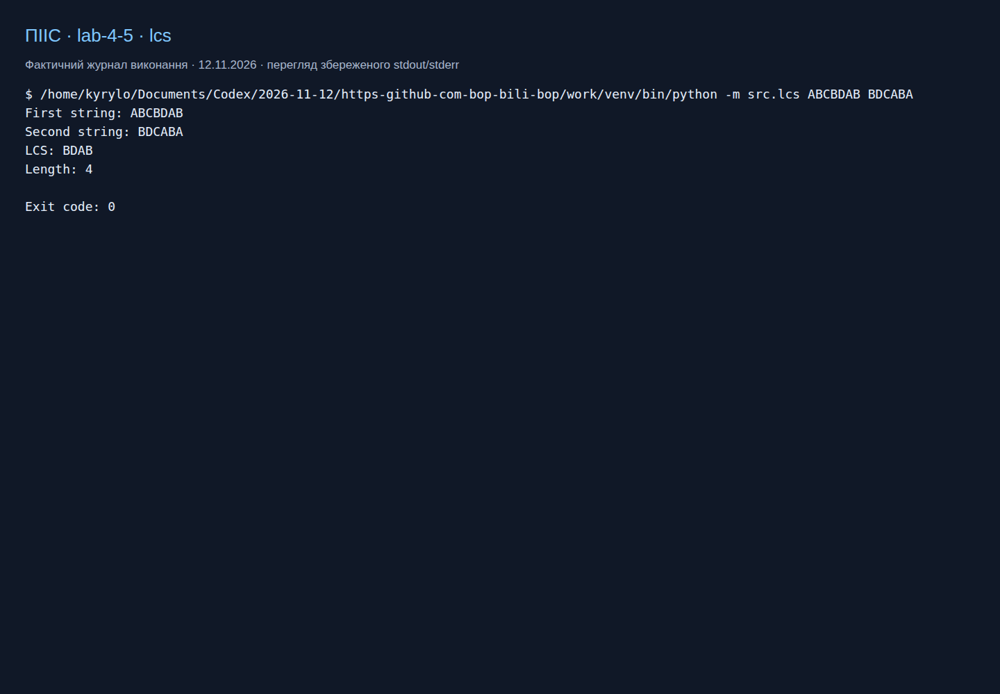
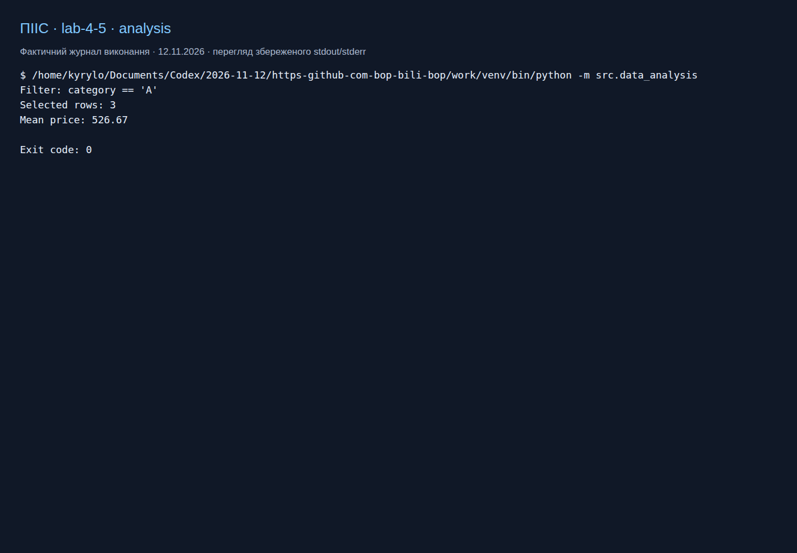
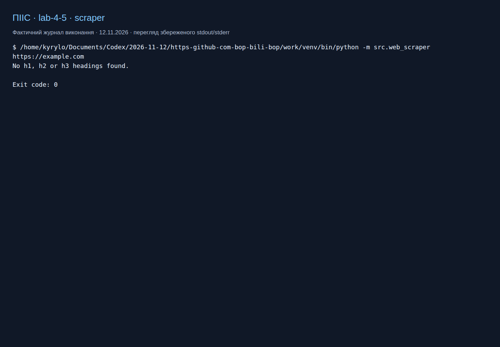
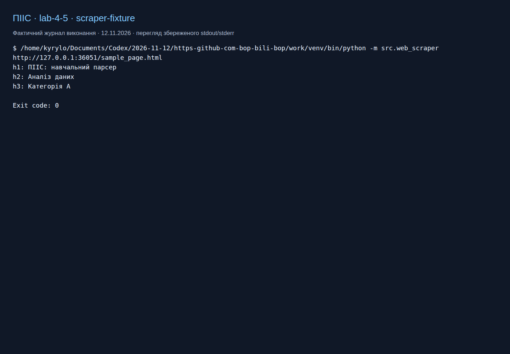
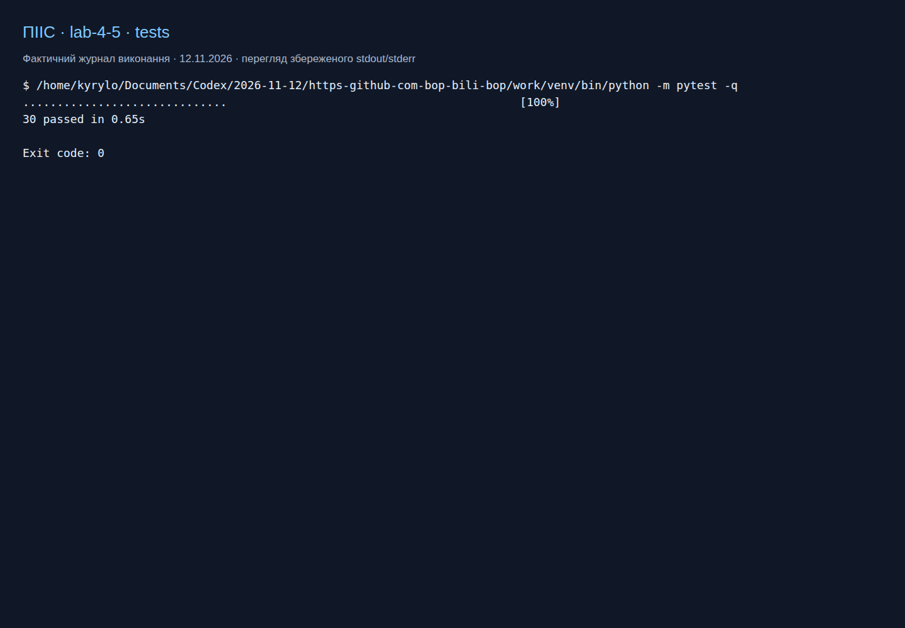
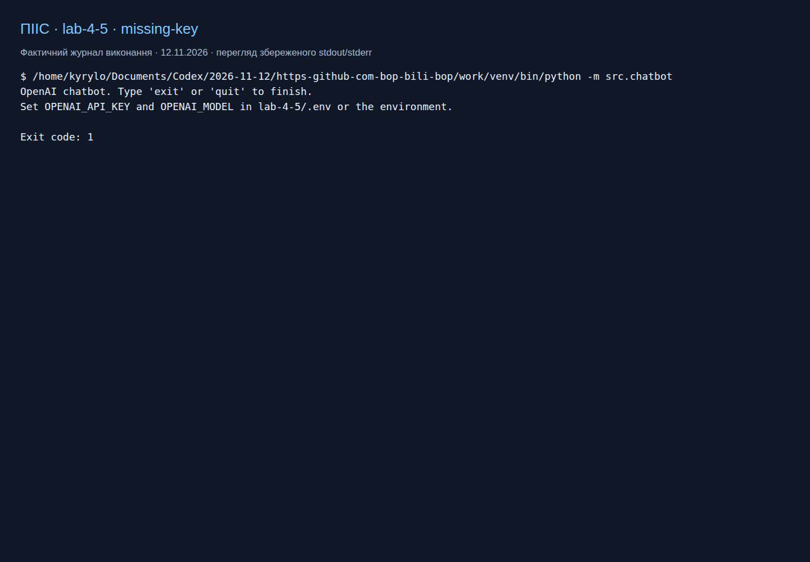
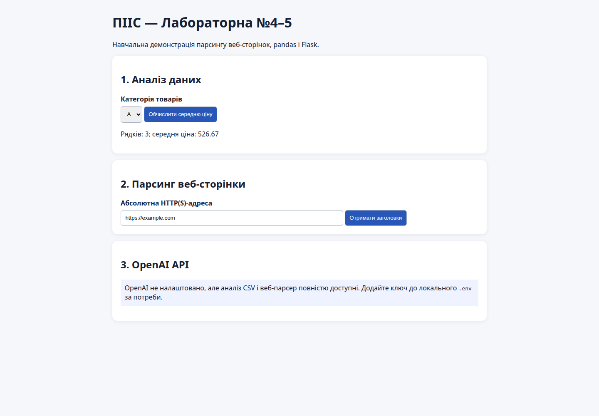
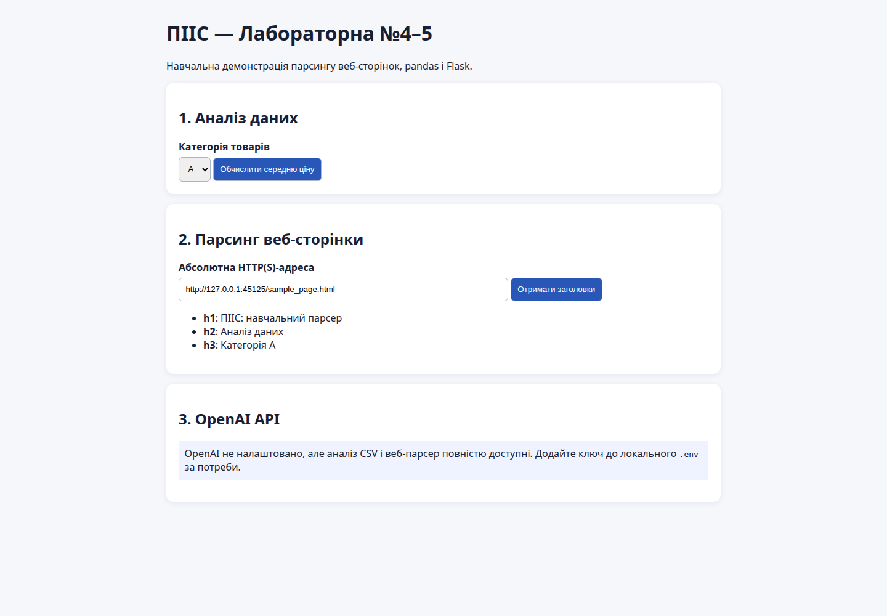

# Лабораторна робота №4–5

## Тема і мета

Програмування на Python за допомогою штучного інтелекту ChatGPT.
Одна робота за спільною методичкою №4–5 охоплює інтеграцію API, чат-бот,
генерацію алгоритму LCS, парсинг вебсторінок, аналіз CSV та вебзастосунок Flask.
Мета — навчитися словесно задавати алгоритми, створювати код за допомогою ШІ
й перевіряти його працездатність на конкретних прикладах.

Окремого переліку індивідуальних варіантів у PDF №4–5 немає. Для алгоритмічної
частини збережено LCS з початкового репозиторію та прикладу методички.
Всі частини розміщено в одному пакеті `src`, з одним `requirements.txt`,
одним `.env` і спільним набором із 30 тестів.

## Використання ШІ та API

Код доопрацьовано за допомогою ШІ в цьому сеансі Codex. Підготовлений запит
генерації LCS збережено в `prompts/algorithm-generation-prompt.txt`.
Модуль `src.generate_algorithm` може відправити його OpenAI; відповідь тільки
друкується й ніколи не виконується автоматично.

Використано офіційний Python SDK і Responses API за
[офіційною документацією](https://developers.openai.com/api/docs/guides/text?lang=python).
Для живого запиту потрібно створити власний API-ключ на
[платформі OpenAI](https://platform.openai.com/), скопіювати `.env.example`
у `.env` та задати `OPENAI_API_KEY` і доступну акаунту `OPENAI_MODEL`.
Ключ не додається до Git.

Ключ та доступ до акаунта не надавались, тому створення ключа і живий
API-діалог не виконано. Вигаданих API-відповідей або скріншотів немає.
Тести з підміною клієнта перевіряють логіку запиту, але не доступ до сервісу.

## Словесні алгоритми

### 1. Чат-бот

Завантажити налаштування з єдиного `.env`, перевірити ключ і модель, створити
клієнт з тайм-аутом та обмеженими повторними спробами. У циклі читати
повідомлення, передавати історію до `responses.create` й отримувати
`output_text`. Додавати до історії тільки успішний обмін. Порожні повідомлення,
порожні відповіді й помилки API обробляти явно; вихід — exit/quit, EOF або Ctrl+C.
Деталі винятків SDK із даними запиту не виводити.

### 2. Найдовша спільна підпослідовність (LCS)

Створити таблицю довжин LCS для всіх пар префіксів двох рядків. Нульовий
рядок і стовпець містять нулі. Якщо поточні символи збігаються, взяти
діагонального попередника плюс 1; інакше — максимум зверху та зліва.
Відновити відповідь із правого нижнього кута: при збігу додати символ і
перейти по діагоналі, інакше перейти до більшого сусіда. Розвернути символи.
Час O(nm), пам'ять O(nm). Символи підпослідовності можуть бути розділені
іншими символами у вхідному рядку.

### 3. Парсинг HTML

Перевірити абсолютну HTTP(S)-адресу, отримати сторінку з тайм-аутом,
перевірити HTTP-статус. Якщо сервер явно задав charset, використати його;
інакше розбирати початкові байти, щоб BeautifulSoup міг прочитати meta charset.
Вибрати h1/h2/h3 у порядку документа та очистити їхній текст.
Мережева помилка перетворюється на контрольовану помилку програми.

### 4. Аналіз CSV

Прочитати CSV у pandas, перевірити потрібні колонки та числовий тип колонки
середнього. Відібрати рядки заданої категорії, повернути їхню кількість і
арифметичне середнє. Відсутній файл, колонка або порожня вибірка — помилка.

### 5. Flask

GET / показує форми, POST /analyze аналізує локальний CSV,
POST /scrape отримує заголовки вказаного URL. Jinja екранує текст сторінки.
Сервер працює на 127.0.0.1, debug вимкнено. Інтерфейс має спільну назву
«Лабораторна №4–5» і показує наявність ключа OpenAI без його значення.

## Текст налагоджених програм із коментарями

### `src/openai_client.py`

```python
"""OpenAI Responses API for the assignment; credentials stay in the local .env."""
from __future__ import annotations

import os
from pathlib import Path

from dotenv import load_dotenv
from openai import OpenAI, OpenAIError

ENV_FILE = Path(__file__).resolve().parents[1] / ".env"


class OpenAIConfigurationError(RuntimeError):
    """Missing credentials or model selection."""


def create_client() -> tuple[OpenAI, str]:
    load_dotenv(ENV_FILE)
    key = os.getenv("OPENAI_API_KEY", "").strip()
    model = os.getenv("OPENAI_MODEL", "").strip()
    if not key or not model:
        raise OpenAIConfigurationError(
            "Set OPENAI_API_KEY and OPENAI_MODEL in lab-4-5/.env or the environment."
        )
    return OpenAI(api_key=key, timeout=30.0, max_retries=1), model


def generate_text(prompt: str, *, client=None, model: str | None = None,
                  history: list[dict[str, str]] | None = None) -> str:
    """Generate text; append a completed turn only after a successful response."""
    if not prompt.strip():
        raise ValueError("Prompt must not be empty.")
    if client is None:
        client, model = create_client()
    if not model:
        raise ValueError("Model must not be empty.")
    messages = [*(history or []), {"role": "user", "content": prompt}]
    try:
        response = client.responses.create(model=model, input=messages, store=False)
    except OpenAIError as exc:
        # SDK messages may contain request details: do not print them or a key.
        raise RuntimeError(f"OpenAI request failed ({type(exc).__name__}).") from exc
    text = response.output_text
    if not text or not text.strip():
        raise RuntimeError("OpenAI returned an empty text response.")
    if history is not None:
        history.extend([messages[-1], {"role": "assistant", "content": text}])
    return text
```

### `src/chatbot.py`

```python
"""Console ChatGPT/OpenAI chatbot with conversation history."""
from __future__ import annotations

try:
    from .openai_client import OpenAIConfigurationError, create_client, generate_text
except ImportError:  # python src/chatbot.py
    from openai_client import OpenAIConfigurationError, create_client, generate_text


def main() -> int:
    print("OpenAI chatbot. Type 'exit' or 'quit' to finish.")
    try:
        client, model = create_client()
    except OpenAIConfigurationError as exc:
        print(exc)
        return 1
    history: list[dict[str, str]] = []
    with client:
        while True:
            try:
                message = input("\nYou: ").strip()
            except (EOFError, KeyboardInterrupt):
                print("\nGoodbye!")
                return 0
            if message.lower() in {"exit", "quit"}:
                print("Goodbye!")
                return 0
            if not message:
                print("Please enter a message.")
                continue
            try:
                print("Assistant:", generate_text(message, client=client,
                                                   model=model, history=history))
            except (ValueError, RuntimeError) as exc:
                print(exc)


if __name__ == "__main__":
    raise SystemExit(main())
```

### `src/generate_algorithm.py`

```python
"""Submit the saved LCS prompt to OpenAI; never execute generated code."""
from pathlib import Path
from .openai_client import create_client, generate_text


def main() -> int:
    prompt = (Path(__file__).resolve().parents[1] / "prompts" /
              "algorithm-generation-prompt.txt").read_text(encoding="utf-8")
    try:
        client, model = create_client()
        with client:
            print(generate_text(prompt, client=client, model=model))
    except (ValueError, RuntimeError) as exc:
        print(exc)
        return 1
    return 0


if __name__ == "__main__":
    raise SystemExit(main())
```

### `src/lcs.py`

```python
"""Longest Common Subsequence (LCS) using dynamic programming."""

from __future__ import annotations

import argparse


def _length_table(first: str, second: str) -> list[list[int]]:
    """Build table[i][j] containing the LCS length for two prefixes."""
    table = [[0] * (len(second) + 1) for _ in range(len(first) + 1)]
    for i, left_character in enumerate(first, start=1):
        for j, right_character in enumerate(second, start=1):
            if left_character == right_character:
                table[i][j] = table[i - 1][j - 1] + 1
            else:
                table[i][j] = max(table[i - 1][j], table[i][j - 1])
    return table


def longest_common_subsequence(first: str, second: str) -> str:
    """Return one longest subsequence shared by *first* and *second*."""
    table = _length_table(first, second)
    i, j = len(first), len(second)
    reversed_result: list[str] = []

    # Walk backwards from the bottom-right cell to reconstruct an actual LCS.
    while i > 0 and j > 0:
        if first[i - 1] == second[j - 1]:
            reversed_result.append(first[i - 1])
            i -= 1
            j -= 1
        elif table[i - 1][j] > table[i][j - 1]:
            i -= 1
        else:
            j -= 1

    return "".join(reversed(reversed_result))


def lcs_length(first: str, second: str) -> int:
    """Return the length of an LCS."""
    return _length_table(first, second)[-1][-1]


def main() -> None:
    parser = argparse.ArgumentParser(description="Find a longest common subsequence.")
    parser.add_argument("first", nargs="?", default="ABCBDAB")
    parser.add_argument("second", nargs="?", default="BDCABA")
    args = parser.parse_args()
    result = longest_common_subsequence(args.first, args.second)
    print(f"First string: {args.first}")
    print(f"Second string: {args.second}")
    print(f"LCS: {result}")
    print(f"Length: {len(result)}")


if __name__ == "__main__":
    main()
```

### `src/web_scraper.py`

```python
"""Extract h1, h2 and h3 headings from web pages."""

from __future__ import annotations

import argparse
from urllib.parse import urlparse

import requests
from bs4 import BeautifulSoup

USER_AGENT = "PIIS-University-Lab/1.0 (educational heading parser)"


class ScraperError(RuntimeError):
    """A controlled URL, network, or parsing error."""


def validate_url(url: str) -> None:
    """Accept only absolute HTTP(S) URLs."""
    parsed = urlparse(url)
    if parsed.scheme not in {"http", "https"} or not parsed.netloc:
        raise ValueError("URL must be an absolute http:// or https:// address.")


def parse_headings(html: str | bytes) -> list[dict[str, str]]:
    """Parse h1/h2/h3 elements from HTML without performing a network call."""
    soup = BeautifulSoup(html, "html.parser")
    return [
        {"level": heading.name, "text": heading.get_text(" ", strip=True)}
        for heading in soup.select("h1, h2, h3")
    ]


def get_headings(url: str, timeout: float = 10.0) -> list[dict[str, str]]:
    """Download *url* and return its h1/h2/h3 headings."""
    validate_url(url)
    try:
        response = requests.get(
            url,
            headers={"User-Agent": USER_AGENT},
            timeout=timeout,
        )
        response.raise_for_status()
    except requests.RequestException as exc:
        raise ScraperError(f"Could not retrieve {url}: {exc}") from exc
    # Requests defaults to Latin-1 for text/html without a charset header.
    # Let BeautifulSoup read the HTML meta charset from the original bytes.
    html = (response.text if "charset=" in response.headers.get("Content-Type", "").lower()
            else response.content)
    return parse_headings(html)


def main() -> int:
    parser = argparse.ArgumentParser(description="Extract h1-h3 page headings.")
    parser.add_argument("url", nargs="?", default="https://example.com")
    args = parser.parse_args()
    try:
        headings = get_headings(args.url)
    except (ValueError, ScraperError) as exc:
        print(f"Error: {exc}")
        return 1

    if not headings:
        print("No h1, h2 or h3 headings found.")
    else:
        for heading in headings:
            print(f"{heading['level']}: {heading['text']}")
    return 0


if __name__ == "__main__":
    raise SystemExit(main())
```

### `src/data_analysis.py`

```python
"""Small reusable pandas CSV analysis for laboratory work №4–5."""

from __future__ import annotations

import argparse
from pathlib import Path
from typing import TypedDict

import pandas as pd
from pandas.api.types import is_numeric_dtype


class AnalysisResult(TypedDict):
    selected_rows: int
    mean: float


def analyze_csv(
    file_path: str | Path,
    filter_column: str,
    filter_value: str,
    mean_column: str,
) -> AnalysisResult:
    """Filter CSV rows and calculate a numeric column's arithmetic mean."""
    path = Path(file_path)
    if not path.is_file():
        raise FileNotFoundError(f"CSV file does not exist: {path}")

    frame = pd.read_csv(path)
    missing = [name for name in (filter_column, mean_column) if name not in frame]
    if missing:
        raise ValueError(f"CSV column does not exist: {', '.join(missing)}")
    if not is_numeric_dtype(frame[mean_column]):
        raise ValueError(f"Mean column must be numeric: {mean_column}")

    # Compare as strings so command-line values work for text and simple numbers.
    selected = frame[frame[filter_column].astype(str) == str(filter_value)]
    if selected.empty:
        raise ValueError(
            f"No rows where {filter_column} equals {filter_value!r}."
        )

    return {
        "selected_rows": int(len(selected)),
        "mean": float(selected[mean_column].mean()),
    }


def main() -> int:
    default_csv = Path(__file__).resolve().parents[1] / "data" / "sample_data.csv"
    parser = argparse.ArgumentParser(description="Filter a CSV and calculate mean.")
    parser.add_argument("file", nargs="?", default=str(default_csv))
    parser.add_argument("--filter-column", default="category")
    parser.add_argument("--filter-value", default="A")
    parser.add_argument("--mean-column", default="price")
    args = parser.parse_args()
    try:
        result = analyze_csv(
            args.file, args.filter_column, args.filter_value, args.mean_column
        )
    except (FileNotFoundError, ValueError, pd.errors.ParserError) as exc:
        print(f"Error: {exc}")
        return 1

    print(f"Filter: {args.filter_column} == {args.filter_value!r}")
    print(f"Selected rows: {result['selected_rows']}")
    print(f"Mean {args.mean_column}: {result['mean']:.2f}")
    return 0


if __name__ == "__main__":
    raise SystemExit(main())
```

### `src/app.py`

```python
"""Flask demonstration application for PIIS laboratory work №4–5."""

from __future__ import annotations

import os
from pathlib import Path

from dotenv import load_dotenv
from flask import Flask, render_template, request

try:
    from .data_analysis import analyze_csv
    from .web_scraper import ScraperError, get_headings
except ImportError:  # Allows: python src/app.py
    from data_analysis import analyze_csv
    from web_scraper import ScraperError, get_headings

LAB_ROOT = Path(__file__).resolve().parents[1]
load_dotenv(LAB_ROOT / ".env")

app = Flask(__name__, template_folder=str(LAB_ROOT / "templates"))


def page_context(**updates: object) -> dict[str, object]:
    context: dict[str, object] = {
        "analysis": None,
        "headings": None,
        "error": None,
        "openai_configured": bool(os.getenv("OPENAI_API_KEY", "").strip()),
    }
    context.update(updates)
    return context


@app.get("/")
def index():
    return render_template("index.html", **page_context())


@app.post("/analyze")
def analyze():
    try:
        result = analyze_csv(
            LAB_ROOT / "data" / "sample_data.csv",
            "category",
            request.form.get("category", "A"),
            "price",
        )
        return render_template("index.html", **page_context(analysis=result))
    except (FileNotFoundError, ValueError) as exc:
        return render_template("index.html", **page_context(error=str(exc))), 400


@app.post("/scrape")
def scrape():
    url = request.form.get("url", "").strip()
    try:
        headings = get_headings(url)
        return render_template("index.html", **page_context(headings=headings))
    except (ValueError, ScraperError) as exc:
        return render_template("index.html", **page_context(error=str(exc))), 400


if __name__ == "__main__":
    app.run(host="127.0.0.1", debug=False)
```

### `data/sample_data.csv`

```csv
product,category,price,quantity
Laptop,A,1200,2
Mouse,B,30,10
Keyboard,A,80,4
Monitor,A,300,3
Headphones,B,100,5
```

### `prompts/algorithm-generation-prompt.txt`

```text
Напиши зрозумілу функцію Python 3.11, яка знаходить один із найдовших
спільних підпослідовностей (Longest Common Subsequence, LCS) двох
рядків методом динамічного програмування. Функція повинна повертати саму
підпослідовність, а не лише її довжину. Поясни побудову таблиці, відновлення
відповіді, часову та просторову складність. Додай приклади для звичайних,
порожніх і однакових рядків та короткі pytest-тести. Не використовуй сторонні
бібліотеки.
```

## Результати фактичного запуску

Перевірено 12.11.2026. Нижче наведено фактичні журнали stdout/stderr та їх
скріншоти у браузерному переглядачі журналів. Це не зображення інтерактивного
термінала. Усі 30 тестів запущено разом одним викликом pytest.

### LCS

[Журнал](results/lcs.txt)



```text
$ /home/kyrylo/Documents/Codex/2026-11-12/https-github-com-bop-bili-bop/work/venv/bin/python -m src.lcs ABCBDAB BDCABA
First string: ABCBDAB
Second string: BDCABA
LCS: BDAB
Length: 4

Exit code: 0
```

### Аналіз CSV

[Журнал](results/analysis.txt)



```text
$ /home/kyrylo/Documents/Codex/2026-11-12/https-github-com-bop-bili-bop/work/venv/bin/python -m src.data_analysis
Filter: category == 'A'
Selected rows: 3
Mean price: 526.67

Exit code: 0
```

### Публічна HTTP-сторінка

[Журнал](results/scraper.txt)



```text
$ /home/kyrylo/Documents/Codex/2026-11-12/https-github-com-bop-bili-bop/work/venv/bin/python -m src.web_scraper https://example.com
No h1, h2 or h3 headings found.

Exit code: 0
```

### Локальний HTTP-приклад

[Журнал](results/scraper-fixture.txt)



```text
$ /home/kyrylo/Documents/Codex/2026-11-12/https-github-com-bop-bili-bop/work/venv/bin/python -m src.web_scraper http://127.0.0.1:36051/sample_page.html
h1: ПІІС: навчальний парсер
h2: Аналіз даних
h3: Категорія A

Exit code: 0
```

### Спільний набір тестів

[Журнал](results/tests.txt)



```text
$ /home/kyrylo/Documents/Codex/2026-11-12/https-github-com-bop-bili-bop/work/venv/bin/python -m pytest -q
..............................                                           [100%]
30 passed in 0.65s

Exit code: 0
```

### Обробка відсутнього API-ключа

[Журнал](results/missing-key.txt)



```text
$ /home/kyrylo/Documents/Codex/2026-11-12/https-github-com-bop-bili-bop/work/venv/bin/python -m src.chatbot
OpenAI chatbot. Type 'exit' or 'quit' to finish.
Set OPENAI_API_KEY and OPENAI_MODEL in lab-4-5/.env or the environment.

Exit code: 1
```

## Перевірка Flask у браузері

Запущено справжній HTTP-сервер на 127.0.0.1:5055 й обидві форми в Chromium.
Аналіз повернув 3 рядки та середню ціну 526.67; локальна HTTP-сторінка —
три заголовки з коректним українським текстом.
[Журнал HTTP-перевірки](results/http.txt).





## Висновок

В одній лабораторній роботі реалізовано OpenAI-клієнт і контекстний чат,
LCS, парсер, аналіз CSV та Flask. Спільний набір із 30 тестів підтвердив
алгоритми, роботу маршрутів, обробку помилок, українське кодування HTML та
логіку API з підміною відповідей. LCS має довжину 4, середня ціна категорії A —
526.67. Форми перевірено через реальні HTTP-запити в браузері.
Живий OpenAI-запит залишається залежним від ключа й доступної моделі акаунта.
