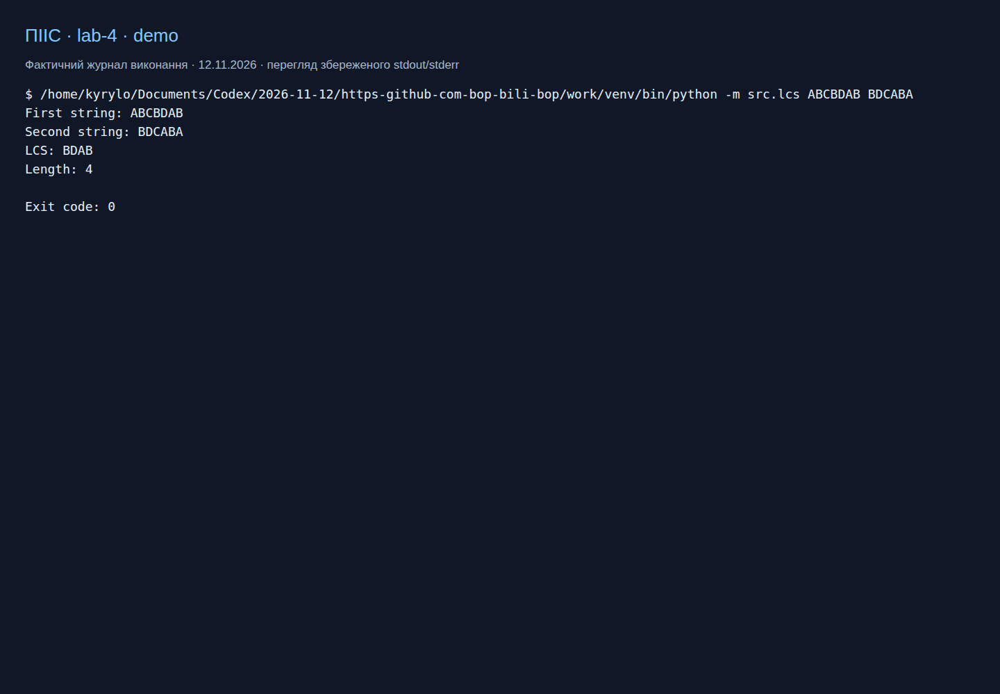
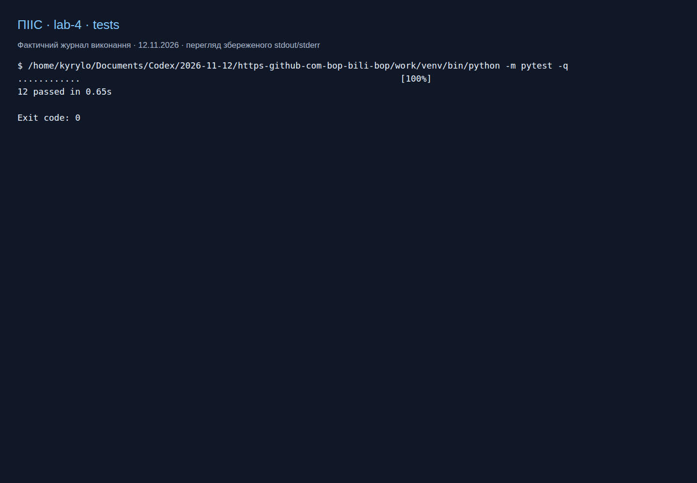
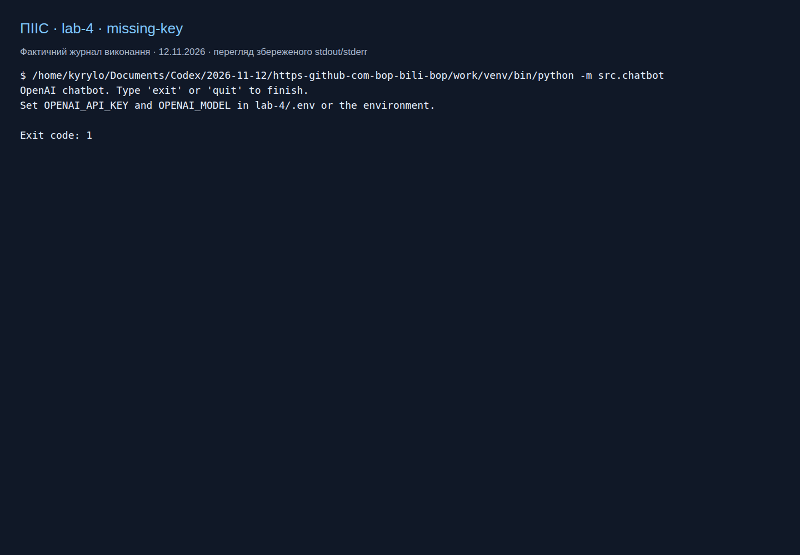

# Лабораторна робота №4 — Python і ChatGPT/OpenAI

## Завдання та мета

Словесно описати алгоритм, реалізувати його на Python за допомогою ШІ,
продемонструвати приклади; створити інтеграцію ChatGPT API і чат-бота.
У PDF №4–5 окремої таблиці індивідуальних варіантів немає, тому збережено
обраний у репозиторії та наведений у методичці алгоритм **LCS**.

## Використання ШІ та відтворення API

Код доопрацьовано за допомогою ШІ у цьому сеансі Codex. Точний підготовлений
запит знаходиться у `prompts/algorithm-generation-prompt.txt`.
`python -m src.generate_algorithm` може повторно відправити його OpenAI.
Відповідь лише друкується: згенерований текст не виконується автоматично.
Текст попередньої «відповіді ChatGPT API» не вигадувався й не зберігався.

API реалізовано через офіційний Python SDK та Responses API згідно з
[офіційною документацією](https://developers.openai.com/api/docs/guides/text?lang=python).
Для запуску слід у своєму акаунті на [платформі OpenAI](https://platform.openai.com/)
створити API-ключ і записати його тільки до локального `.env`, скопійованого
з `.env.example`. `OPENAI_MODEL` потрібно задати моделлю, доступною акаунту.
Файл `.env` ігнорується Git. У цій роботі ключ не створювався: доступ до
акаунта та ключ не надавались. Тому скріншотів створення ключа та живого
API-діалогу немає. Цей етап залишається залежним від облікових даних користувача.

## Чат-бот

`create_client` перевіряє налаштування, задає тайм-аут і обмежує повторні спроби.
`generate_text` передає накопичений список повідомлень у `responses.create`,
читає `output_text` і додає в історію лише успішний обмін.
Порожній запит/відповідь та помилки API обробляються; текст винятків SDK з
деталями запиту не друкується. `exit`/`quit`, EOF і Ctrl+C завершують програму.

## Словесний опис LCS

Створюємо таблицю довжин LCS для всіх пар префіксів двох вхідних рядків.
Нульовий рядок і стовпець містять нулі. Якщо поточні символи збігаються,
додаємо 1 до діагонального попередника. Інакше беремо максимум зверху і зліва.
Після заповнення відновлюємо відповідь із правого нижнього кута: збіг означає
додавання символу і діагональний крок, інакше рухаємося до більшого сусіда.
Символи розвертаємо. Час O(nm), пам'ять O(nm). Це підпослідовність: символи
можуть бути розділені іншими символами в початкових рядках.

## Текст налагоджених програм і запит

### `lab-4/src/lcs.py`

```python
"""Longest Common Subsequence (LCS) using dynamic programming."""

from __future__ import annotations

import argparse


def _length_table(first: str, second: str) -> list[list[int]]:
    """Build table[i][j] containing the LCS length for two prefixes."""
    table = [[0] * (len(second) + 1) for _ in range(len(first) + 1)]
    for i, left_character in enumerate(first, start=1):
        for j, right_character in enumerate(second, start=1):
            if left_character == right_character:
                table[i][j] = table[i - 1][j - 1] + 1
            else:
                table[i][j] = max(table[i - 1][j], table[i][j - 1])
    return table


def longest_common_subsequence(first: str, second: str) -> str:
    """Return one longest subsequence shared by *first* and *second*."""
    table = _length_table(first, second)
    i, j = len(first), len(second)
    reversed_result: list[str] = []

    # Walk backwards from the bottom-right cell to reconstruct an actual LCS.
    while i > 0 and j > 0:
        if first[i - 1] == second[j - 1]:
            reversed_result.append(first[i - 1])
            i -= 1
            j -= 1
        elif table[i - 1][j] > table[i][j - 1]:
            i -= 1
        else:
            j -= 1

    return "".join(reversed(reversed_result))


def lcs_length(first: str, second: str) -> int:
    """Return the length of an LCS."""
    return _length_table(first, second)[-1][-1]


def main() -> None:
    parser = argparse.ArgumentParser(description="Find a longest common subsequence.")
    parser.add_argument("first", nargs="?", default="ABCBDAB")
    parser.add_argument("second", nargs="?", default="BDCABA")
    args = parser.parse_args()
    result = longest_common_subsequence(args.first, args.second)
    print(f"First string: {args.first}")
    print(f"Second string: {args.second}")
    print(f"LCS: {result}")
    print(f"Length: {len(result)}")


if __name__ == "__main__":
    main()
```

### `lab-4/src/openai_client.py`

```python
"""OpenAI Responses API for the assignment; credentials stay in the local .env."""
from __future__ import annotations

import os
from pathlib import Path

from dotenv import load_dotenv
from openai import OpenAI, OpenAIError

ENV_FILE = Path(__file__).resolve().parents[1] / ".env"


class OpenAIConfigurationError(RuntimeError):
    """Missing credentials or model selection."""


def create_client() -> tuple[OpenAI, str]:
    load_dotenv(ENV_FILE)
    key = os.getenv("OPENAI_API_KEY", "").strip()
    model = os.getenv("OPENAI_MODEL", "").strip()
    if not key or not model:
        raise OpenAIConfigurationError(
            "Set OPENAI_API_KEY and OPENAI_MODEL in lab-4/.env or the environment."
        )
    return OpenAI(api_key=key, timeout=30.0, max_retries=1), model


def generate_text(prompt: str, *, client=None, model: str | None = None,
                  history: list[dict[str, str]] | None = None) -> str:
    """Generate text; append a completed turn only after a successful response."""
    if not prompt.strip():
        raise ValueError("Prompt must not be empty.")
    if client is None:
        client, model = create_client()
    if not model:
        raise ValueError("Model must not be empty.")
    messages = [*(history or []), {"role": "user", "content": prompt}]
    try:
        response = client.responses.create(model=model, input=messages, store=False)
    except OpenAIError as exc:
        # SDK messages may contain request details: do not print them or a key.
        raise RuntimeError(f"OpenAI request failed ({type(exc).__name__}).") from exc
    text = response.output_text
    if not text or not text.strip():
        raise RuntimeError("OpenAI returned an empty text response.")
    if history is not None:
        history.extend([messages[-1], {"role": "assistant", "content": text}])
    return text
```

### `lab-4/src/chatbot.py`

```python
"""Console ChatGPT/OpenAI chatbot with conversation history."""
from __future__ import annotations

try:
    from .openai_client import OpenAIConfigurationError, create_client, generate_text
except ImportError:  # python src/chatbot.py
    from openai_client import OpenAIConfigurationError, create_client, generate_text


def main() -> int:
    print("OpenAI chatbot. Type 'exit' or 'quit' to finish.")
    try:
        client, model = create_client()
    except OpenAIConfigurationError as exc:
        print(exc)
        return 1
    history: list[dict[str, str]] = []
    with client:
        while True:
            try:
                message = input("\nYou: ").strip()
            except (EOFError, KeyboardInterrupt):
                print("\nGoodbye!")
                return 0
            if message.lower() in {"exit", "quit"}:
                print("Goodbye!")
                return 0
            if not message:
                print("Please enter a message.")
                continue
            try:
                print("Assistant:", generate_text(message, client=client,
                                                   model=model, history=history))
            except (ValueError, RuntimeError) as exc:
                print(exc)


if __name__ == "__main__":
    raise SystemExit(main())
```

### `lab-4/src/generate_algorithm.py`

```python
"""Submit the saved LCS prompt to OpenAI; never execute generated code."""
from pathlib import Path
from .openai_client import create_client, generate_text


def main() -> int:
    prompt = (Path(__file__).resolve().parents[1] / "prompts" /
              "algorithm-generation-prompt.txt").read_text(encoding="utf-8")
    try:
        client, model = create_client()
        with client:
            print(generate_text(prompt, client=client, model=model))
    except (ValueError, RuntimeError) as exc:
        print(exc)
        return 1
    return 0


if __name__ == "__main__":
    raise SystemExit(main())
```

### `lab-4/prompts/algorithm-generation-prompt.txt`

```text
Напиши зрозумілу функцію Python 3.11, яка знаходить один із найдовших
спільних підпослідовностей (Longest Common Subsequence, LCS) двох
рядків методом динамічного програмування. Функція повинна повертати саму
підпослідовність, а не лише її довжину. Поясни побудову таблиці, відновлення
відповіді, часову та просторову складність. Додай приклади для звичайних,
порожніх і однакових рядків та короткі pytest-тести. Не використовуй сторонні
бібліотеки.
```

## Результати фактичного запуску

Перевірено 12.11.2026. PNG нижче — скріншоти перегляду збережених журналів
stdout/stderr у браузері. Це не зображення інтерактивного термінала.
Початкові текстові журнали доступні поруч для перевірки.

### demo

[Повний журнал](results/demo.txt)



```text
$ /home/kyrylo/Documents/Codex/2026-11-12/https-github-com-bop-bili-bop/work/venv/bin/python -m src.lcs ABCBDAB BDCABA
First string: ABCBDAB
Second string: BDCABA
LCS: BDAB
Length: 4

Exit code: 0
```

### tests

[Повний журнал](results/tests.txt)



```text
$ /home/kyrylo/Documents/Codex/2026-11-12/https-github-com-bop-bili-bop/work/venv/bin/python -m pytest -q
............                                                             [100%]
12 passed in 0.65s

Exit code: 0
```

### missing-key

[Повний журнал](results/missing-key.txt)



```text
$ /home/kyrylo/Documents/Codex/2026-11-12/https-github-com-bop-bili-bop/work/venv/bin/python -m src.chatbot
OpenAI chatbot. Type 'exit' or 'quit' to finish.
Set OPENAI_API_KEY and OPENAI_MODEL in lab-4/.env or the environment.

Exit code: 1
```

## Межі перевірки

12 автоматичних тестів перевіряють LCS та інтеграційну логіку OpenAI з
підміною клієнта: контекст, параметри запиту, збій, повторний запит, порожню
відповідь, відсутні налаштування та вихід із чат-бота. Підміна не підтверджує
доступність зовнішнього API. Живий запит без ключа не виконувався.

## Висновок

Реалізовано і перевірено алгоритм LCS, конфігурацію OpenAI, контекстний чат
та повторне надсилання запиту генерації. Успішність алгоритму підтверджена
перевірками оптимальної довжини та належності результату обом рядкам.
Жива API-демонстрація потребує ключа та доступної моделі.
