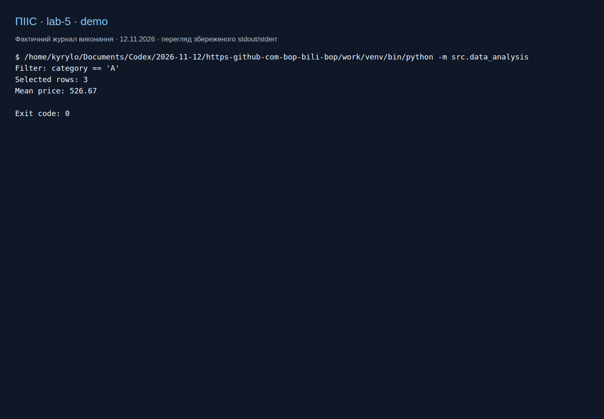
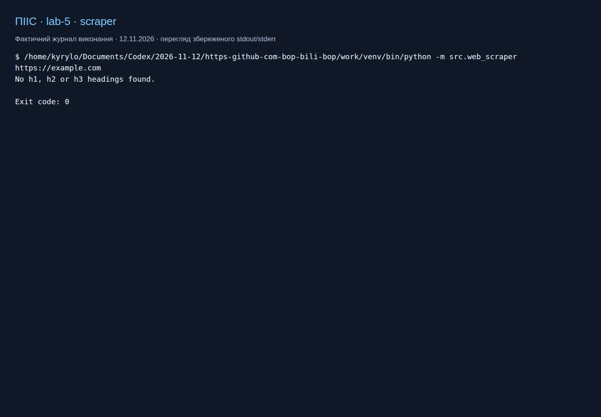
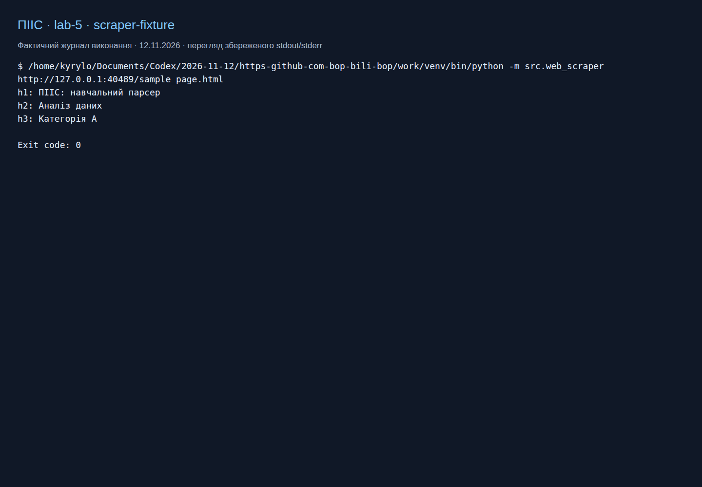
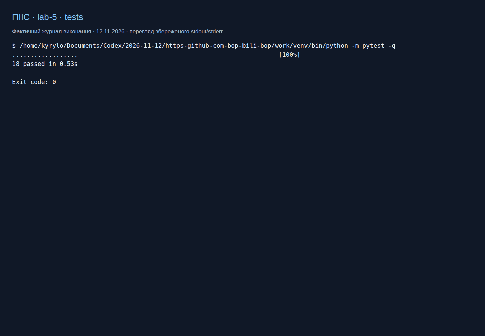
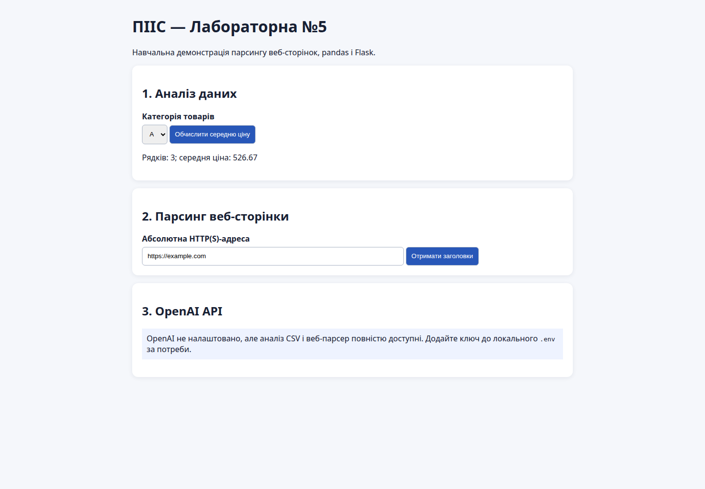
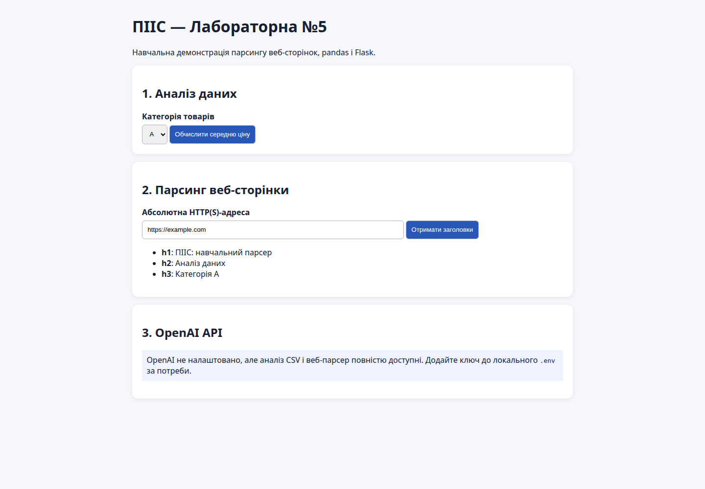

# Лабораторна робота №5 — Python, парсинг, аналіз і Flask

## Завдання та мета

Виконати приклади розробки Python за допомогою ШІ з методички №4–5:
парсинг HTML, імпорт/фільтрація/усереднення даних, простий вебзастосунок.
Окремого номера індивідуального варіанта для №4–5 в PDF немає.

## Словесні алгоритми

1. **Парсер:** перевірити абсолютну HTTP(S)-адресу, завантажити HTML із
тайм-аутом, перевірити HTTP-статус, розібрати BeautifulSoup і повернути
заголовки h1/h2/h3 у порядку документа з очищеним текстом.
2. **Аналіз:** прочитати CSV у pandas, перевірити потрібні колонки та числовий
тип значення, відібрати рядки заданої категорії, обчислити арифметичне середнє.
Порожня вибірка — контрольована помилка.
3. **Flask:** GET / показує форми, POST /analyze запускає аналіз локального
набору, POST /scrape отримує заголовки URL. Jinja екранує отриманий текст.
Сервер прив'язано до 127.0.0.1, debug вимкнено. Стан OPENAI_API_KEY показується
без його значення; повна інтеграція API знаходиться в лабораторній №4.

## Використання ШІ

Код доопрацьовано за допомогою ШІ у сеансі Codex. Завдання для генерації:
«Напиши Python-парсер h1/h2/h3 на requests і BeautifulSoup з тайм-аутом,
аналіз CSV через pandas з фільтром категорії та середнім і Flask-сторінку для
цих операцій. Додай перевірки помилок та автоматичні тести».
Живий виклик OpenAI API не був потрібний для виконання цих локальних програм.

## Програми з коментарями та вихідні дані

### `lab-5/src/web_scraper.py`

```python
"""Extract h1, h2 and h3 headings from web pages."""

from __future__ import annotations

import argparse
from urllib.parse import urlparse

import requests
from bs4 import BeautifulSoup

USER_AGENT = "PIIS-University-Lab/1.0 (educational heading parser)"


class ScraperError(RuntimeError):
    """A controlled URL, network, or parsing error."""


def validate_url(url: str) -> None:
    """Accept only absolute HTTP(S) URLs."""
    parsed = urlparse(url)
    if parsed.scheme not in {"http", "https"} or not parsed.netloc:
        raise ValueError("URL must be an absolute http:// or https:// address.")


def parse_headings(html: str | bytes) -> list[dict[str, str]]:
    """Parse h1/h2/h3 elements from HTML without performing a network call."""
    soup = BeautifulSoup(html, "html.parser")
    return [
        {"level": heading.name, "text": heading.get_text(" ", strip=True)}
        for heading in soup.select("h1, h2, h3")
    ]


def get_headings(url: str, timeout: float = 10.0) -> list[dict[str, str]]:
    """Download *url* and return its h1/h2/h3 headings."""
    validate_url(url)
    try:
        response = requests.get(
            url,
            headers={"User-Agent": USER_AGENT},
            timeout=timeout,
        )
        response.raise_for_status()
    except requests.RequestException as exc:
        raise ScraperError(f"Could not retrieve {url}: {exc}") from exc
    # Requests defaults to Latin-1 for text/html without a charset header.
    # Let BeautifulSoup read the HTML meta charset from the original bytes.
    html = (response.text if "charset=" in response.headers.get("Content-Type", "").lower()
            else response.content)
    return parse_headings(html)


def main() -> int:
    parser = argparse.ArgumentParser(description="Extract h1-h3 page headings.")
    parser.add_argument("url", nargs="?", default="https://example.com")
    args = parser.parse_args()
    try:
        headings = get_headings(args.url)
    except (ValueError, ScraperError) as exc:
        print(f"Error: {exc}")
        return 1

    if not headings:
        print("No h1, h2 or h3 headings found.")
    else:
        for heading in headings:
            print(f"{heading['level']}: {heading['text']}")
    return 0


if __name__ == "__main__":
    raise SystemExit(main())
```

### `lab-5/src/data_analysis.py`

```python
"""Small reusable pandas CSV analysis for laboratory work №5."""

from __future__ import annotations

import argparse
from pathlib import Path
from typing import TypedDict

import pandas as pd
from pandas.api.types import is_numeric_dtype


class AnalysisResult(TypedDict):
    selected_rows: int
    mean: float


def analyze_csv(
    file_path: str | Path,
    filter_column: str,
    filter_value: str,
    mean_column: str,
) -> AnalysisResult:
    """Filter CSV rows and calculate a numeric column's arithmetic mean."""
    path = Path(file_path)
    if not path.is_file():
        raise FileNotFoundError(f"CSV file does not exist: {path}")

    frame = pd.read_csv(path)
    missing = [name for name in (filter_column, mean_column) if name not in frame]
    if missing:
        raise ValueError(f"CSV column does not exist: {', '.join(missing)}")
    if not is_numeric_dtype(frame[mean_column]):
        raise ValueError(f"Mean column must be numeric: {mean_column}")

    # Compare as strings so command-line values work for text and simple numbers.
    selected = frame[frame[filter_column].astype(str) == str(filter_value)]
    if selected.empty:
        raise ValueError(
            f"No rows where {filter_column} equals {filter_value!r}."
        )

    return {
        "selected_rows": int(len(selected)),
        "mean": float(selected[mean_column].mean()),
    }


def main() -> int:
    default_csv = Path(__file__).resolve().parents[1] / "data" / "sample_data.csv"
    parser = argparse.ArgumentParser(description="Filter a CSV and calculate mean.")
    parser.add_argument("file", nargs="?", default=str(default_csv))
    parser.add_argument("--filter-column", default="category")
    parser.add_argument("--filter-value", default="A")
    parser.add_argument("--mean-column", default="price")
    args = parser.parse_args()
    try:
        result = analyze_csv(
            args.file, args.filter_column, args.filter_value, args.mean_column
        )
    except (FileNotFoundError, ValueError, pd.errors.ParserError) as exc:
        print(f"Error: {exc}")
        return 1

    print(f"Filter: {args.filter_column} == {args.filter_value!r}")
    print(f"Selected rows: {result['selected_rows']}")
    print(f"Mean {args.mean_column}: {result['mean']:.2f}")
    return 0


if __name__ == "__main__":
    raise SystemExit(main())
```

### `lab-5/src/app.py`

```python
"""Flask demonstration application for PIIS laboratory work №5."""

from __future__ import annotations

import os
from pathlib import Path

from dotenv import load_dotenv
from flask import Flask, render_template, request

try:
    from .data_analysis import analyze_csv
    from .web_scraper import ScraperError, get_headings
except ImportError:  # Allows: python src/app.py
    from data_analysis import analyze_csv
    from web_scraper import ScraperError, get_headings

LAB_ROOT = Path(__file__).resolve().parents[1]
load_dotenv(LAB_ROOT / ".env")

app = Flask(__name__, template_folder=str(LAB_ROOT / "templates"))


def page_context(**updates: object) -> dict[str, object]:
    context: dict[str, object] = {
        "analysis": None,
        "headings": None,
        "error": None,
        "openai_configured": bool(os.getenv("OPENAI_API_KEY", "").strip()),
    }
    context.update(updates)
    return context


@app.get("/")
def index():
    return render_template("index.html", **page_context())


@app.post("/analyze")
def analyze():
    try:
        result = analyze_csv(
            LAB_ROOT / "data" / "sample_data.csv",
            "category",
            request.form.get("category", "A"),
            "price",
        )
        return render_template("index.html", **page_context(analysis=result))
    except (FileNotFoundError, ValueError) as exc:
        return render_template("index.html", **page_context(error=str(exc))), 400


@app.post("/scrape")
def scrape():
    url = request.form.get("url", "").strip()
    try:
        headings = get_headings(url)
        return render_template("index.html", **page_context(headings=headings))
    except (ValueError, ScraperError) as exc:
        return render_template("index.html", **page_context(error=str(exc))), 400


if __name__ == "__main__":
    app.run(host="127.0.0.1", debug=False)
```

### `lab-5/data/sample_data.csv`

```csv
product,category,price,quantity
Laptop,A,1200,2
Mouse,B,30,10
Keyboard,A,80,4
Monitor,A,300,3
Headphones,B,100,5
```

## Результати фактичного запуску

Перевірено 12.11.2026. PNG нижче — скріншоти перегляду збережених журналів
stdout/stderr у браузері. Це не зображення інтерактивного термінала.
Початкові текстові журнали доступні поруч для перевірки.

### demo

[Повний журнал](results/demo.txt)



```text
$ /home/kyrylo/Documents/Codex/2026-11-12/https-github-com-bop-bili-bop/work/venv/bin/python -m src.data_analysis
Filter: category == 'A'
Selected rows: 3
Mean price: 526.67

Exit code: 0
```

### scraper

[Повний журнал](results/scraper.txt)



```text
$ /home/kyrylo/Documents/Codex/2026-11-12/https-github-com-bop-bili-bop/work/venv/bin/python -m src.web_scraper https://example.com
No h1, h2 or h3 headings found.

Exit code: 0
```

### scraper-fixture

[Повний журнал](results/scraper-fixture.txt)



```text
$ /home/kyrylo/Documents/Codex/2026-11-12/https-github-com-bop-bili-bop/work/venv/bin/python -m src.web_scraper http://127.0.0.1:40489/sample_page.html
h1: ПІІС: навчальний парсер
h2: Аналіз даних
h3: Категорія A

Exit code: 0
```

### tests

[Повний журнал](results/tests.txt)



```text
$ /home/kyrylo/Documents/Codex/2026-11-12/https-github-com-bop-bili-bop/work/venv/bin/python -m pytest -q
..................                                                       [100%]
18 passed in 0.53s

Exit code: 0
```

## Запуск справжнього HTTP-сервера

Застосунок запущено окремим процесом на 127.0.0.1:5055, відкрито Chromium,
виконано обидві форми. Це скріншоти живого інтерфейсу, а не макети.
[Журнал HTTP-перевірки](results/http.txt).





## Висновок

CSV категорії A містить 3 рядки; середня ціна — 526.67. Живий запит до
example.com повернув HTML без h1–h3. Локальна HTTP-сторінка повернула три заголовки. 18 тестів перевірили обчислення,
помилкові колонки, порожню вибірку, HTML, URL, мережевий збій, тайм-аут,
Flask-маршрути та екранування HTML. Обидві форми також пройшли перевірку
в браузері через реальні HTTP-запити.
