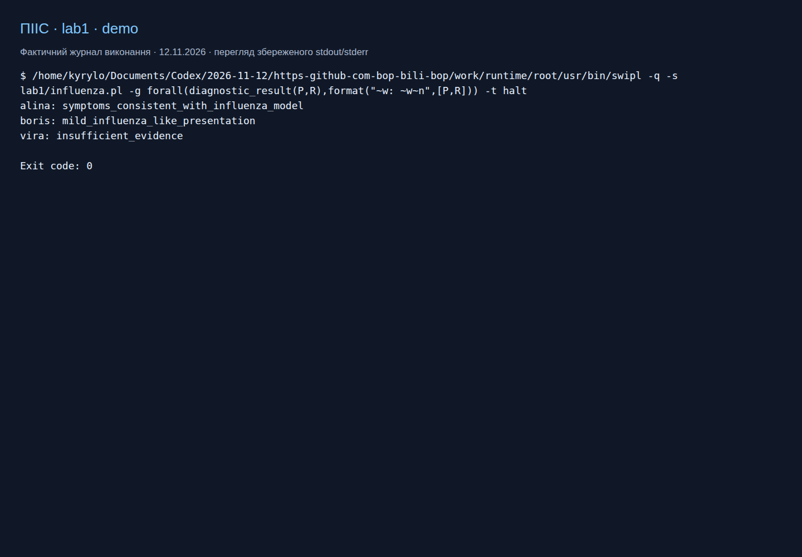
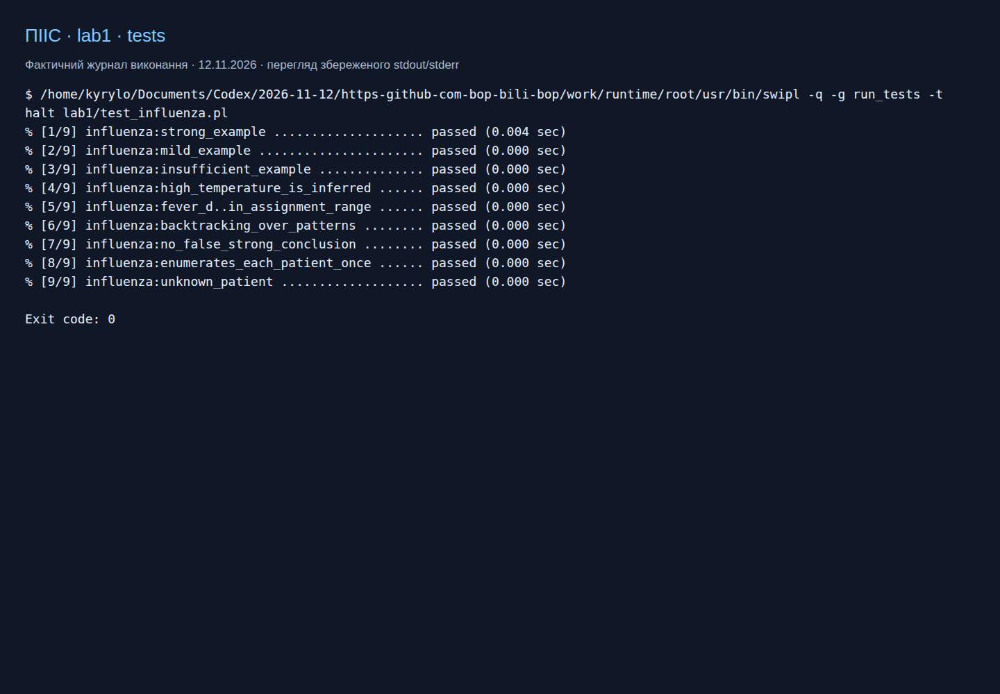

# Лабораторна робота №1 — Prolog

## Завдання та мета

Реалізувати базу знань «Грип», варіант 6; вивчити факти, правила, уніфікацію, пошук із поверненням і вбудовані предикати.

## Предметна область і прийнята модель

Варіант **6 «Грип»**, успадкований з початкової гілки репозиторію.
Опис варіанта: гострий початок, підвищення температури, озноб, головний біль
(лобовий або за очима, що посилюється при русі очей), загальна слабкість,
м'язовий/суглобовий біль і ломота. У PDF наведено також пітливість,
світлобоязнь, кон'юнктивіт, сльозотечу та тяжкі неврологічні прояви.

Для навчальної формалізації прийнято поріг підвищення температури 37.1 °C,
субфебрильний інтервал [37.1, 38.0), дуже високу температуру від 39.5 °C.
Ці числові пороги та наведені нижче комбінації — припущення реалізації,
а не дослівно задані діагностичні критерії PDF і не медичні рекомендації.

Позначення: A — гострий початок, F — температура ≥37.1, W — слабкість,
C — озноб, P — м'язовий/суглобовий біль або ломота,
L — лобовий біль або біль за очима, E — посилення при русі очей,
H — головний біль, B — ломота у тілі, S — субфебрильна температура.

1. Якщо **A ∧ F ∧ W ∧ ((C ∧ P) ∨ (L ∧ E))**, ознаки відповідають моделі грипу.
2. Інакше якщо **A ∧ S ∧ W ∧ (H ∨ B)**, легка грипоподібна картина.
3. Інакше даних для моделі недостатньо.

Перша умова має пріоритет над другою. Відсутній факт означає відсутність
підтвердження у цій навчальній моделі. Це не підтвердження відсутності симптому.
Для порівняння реалізацій використано повністю задані булеві набори ознак.

## Основні відмінності Prolog від процедурних мов

Prolog описує відношення, а запит шукає значення змінних, які задовольняють
ці відношення. У Pascal/C++ зазвичай явно задають послідовність команд і
зміни стану. Уніфікація зіставляє терми, пошук із поверненням перебирає
альтернативи; `once/1` обмежує пошук одним доказом. `\+/1` означає неможливість
довести ціль у поточній базі, а не класичне логічне заперечення. Арифметичні
порівняння потребують уже визначених чисел.

## Організація програми

Словник ознак зберігається як факти `symptom/1`, групи — `symptom_group/2`.
`include/1` завантажує спостереження з диска (`observations.pl`).
`finding/2` формує похідні ознаки, `evidence_pattern/2` — комбінації,
`severity/2` — вираженість, `diagnostic_result/2` — один висновок для кожного
відомого пацієнта. `setof/3` прибирає дублікати при переліку пацієнтів;
змінна пацієнта зв'язується перед `once/1` і запереченням.

## Текст налагодженої програми і база даних

### `lab1/influenza.pl`

```prolog
/** <module> Educational influenza knowledge base (Variant 6).

This program models only the symptom description supplied for the laboratory
assignment.  Its conclusions are labels in a teaching example, not medical
diagnoses.  Missing observations are treated as unknown (and, for the final
fallback conclusion, as absent under Prolog's closed-world assumption).
*/

:- module(influenza,
          [ observation/2,
            symptom/1,
            symptom_group/2,
            temperature/2,
            fever_duration/2,
            finding/2,
            evidence_pattern/2,
            severity/2,
            diagnostic_result/2
          ]).

:- use_module(library(lists), [member/2]).

:- discontiguous observation/2, temperature/2, fever_duration/2.

% Domain vocabulary: these facts make the modeled relationships explicit.
symptom(acute_onset).
symptom(elevated_temperature).
symptom(very_high_temperature).
symptom(chills).
symptom(headache).
symptom(frontal_headache).
symptom(pain_behind_eyes).
symptom(headache_worse_with_eye_movement).
symptom(general_weakness).
symptom(increased_sweating).
symptom(muscle_pain).
symptom(joint_pain).
symptom(body_aches).
symptom(photophobia).
symptom(conjunctivitis).
symptom(tearing).
symptom(vomiting).
symptom(sleep_disorder).
symptom(hallucinations).
symptom(nervous_system_symptom).
symptom(seizures).

symptom_group(acute_onset, onset).
symptom_group(elevated_temperature, fever).
symptom_group(very_high_temperature, fever).
symptom_group(chills, fever).
symptom_group(headache, headache).
symptom_group(frontal_headache, headache).
symptom_group(pain_behind_eyes, headache).
symptom_group(headache_worse_with_eye_movement, headache).
symptom_group(general_weakness, systemic).
symptom_group(increased_sweating, systemic).
symptom_group(muscle_pain, systemic).
symptom_group(joint_pain, systemic).
symptom_group(body_aches, systemic).
symptom_group(photophobia, ocular).
symptom_group(conjunctivitis, ocular).
symptom_group(tearing, ocular).
symptom_group(vomiting, severe).
symptom_group(sleep_disorder, severe).
symptom_group(hallucinations, severe).
symptom_group(nervous_system_symptom, severe).
symptom_group(seizures, severe).

:- dynamic observation/2, temperature/2, fever_duration/2.
:- include('observations.pl').

% Derived findings demonstrate variables, arithmetic comparison and inference.
finding(Patient, Symptom) :-
    observation(Patient, Symptom),
    symptom(Symptom).
finding(Patient, elevated_temperature) :-
    temperature(Patient, Celsius),
    Celsius >= 37.1.
finding(Patient, subfebrile_temperature) :-
    temperature(Patient, Celsius),
    Celsius >= 37.1,
    Celsius < 38.0.
finding(Patient, very_high_temperature) :-
    temperature(Patient, Celsius),
    Celsius >= 39.5.
finding(Patient, usual_fever_period) :-
    fever_duration(Patient, Days),
    between(2, 6, Days).

% A characteristic headache can be established by either of two combinations;
% asking for Pattern also exposes both alternatives through backtracking.
evidence_pattern(Patient, characteristic_headache_frontal) :-
    finding(Patient, frontal_headache),
    finding(Patient, headache_worse_with_eye_movement).
evidence_pattern(Patient, characteristic_headache_retro_orbital) :-
    finding(Patient, pain_behind_eyes),
    finding(Patient, headache_worse_with_eye_movement).

evidence_pattern(Patient, fever_with_chills) :-
    finding(Patient, elevated_temperature),
    finding(Patient, chills).
evidence_pattern(Patient, fever_headache_weakness) :-
    finding(Patient, elevated_temperature),
    ( finding(Patient, headache)
    ; finding(Patient, frontal_headache)
    ; finding(Patient, pain_behind_eyes)
    ),
    finding(Patient, general_weakness).
evidence_pattern(Patient, systemic_aches) :-
    finding(Patient, general_weakness),
    once(( finding(Patient, muscle_pain)
         ; finding(Patient, joint_pain)
         ; finding(Patient, body_aches)
         )).

% Severity is inferred separately from the diagnostic label.
severity(Patient, severe) :-
    finding(Patient, very_high_temperature),
    ( finding(Patient, vomiting)
    ; finding(Patient, hallucinations)
    ; finding(Patient, nervous_system_symptom)
    ; finding(Patient, seizures)
    ).
severity(Patient, pronounced) :-
    finding(Patient, very_high_temperature),
    evidence_pattern(Patient, systemic_aches),
    \+ severity(Patient, severe).
severity(Patient, mild) :-
    finding(Patient, subfebrile_temperature),
    \+ severity(Patient, pronounced),
    \+ severity(Patient, severe).

% Several independently reusable patterns contribute to the strong conclusion.
strong_influenza_evidence(Patient) :-
    finding(Patient, acute_onset),
    evidence_pattern(Patient, fever_with_chills),
    evidence_pattern(Patient, systemic_aches).
strong_influenza_evidence(Patient) :-
    finding(Patient, acute_onset),
    evidence_pattern(Patient, fever_headache_weakness),
    ( evidence_pattern(Patient, characteristic_headache_frontal)
    ; evidence_pattern(Patient, characteristic_headache_retro_orbital)
    ).

mild_influenza_evidence(Patient) :-
    finding(Patient, acute_onset),
    finding(Patient, subfebrile_temperature),
    finding(Patient, general_weakness),
    ( finding(Patient, headache)
    ; finding(Patient, body_aches)
    ).

% Bind each known patient before once/1 or negation: enumeration remains complete.
diagnostic_result(Patient, Result) :-
    known_patient(Patient),
    ( once(strong_influenza_evidence(Patient)) ->
        Result = symptoms_consistent_with_influenza_model
    ; once(mild_influenza_evidence(Patient)) ->
        Result = mild_influenza_like_presentation
    ; Result = insufficient_evidence
    ).

known_patient(Patient) :-
    setof(P, S^T^(observation(P, S); temperature(P, T)), Patients),
    member(Patient, Patients).
```

### `lab1/observations.pl`

```prolog
% Observations loaded from disk; replace these facts for another data set.
% Example 1: a symptom combination strongly matching the model.
temperature(alina, 39.8).
fever_duration(alina, 4).
observation(alina, acute_onset).
observation(alina, chills).
observation(alina, frontal_headache).
observation(alina, headache_worse_with_eye_movement).
observation(alina, general_weakness).
observation(alina, muscle_pain).
observation(alina, body_aches).
observation(alina, photophobia).

% Example 2: a mild influenza-like presentation with subfebrile temperature.
temperature(boris, 37.6).
fever_duration(boris, 2).
observation(boris, acute_onset).
observation(boris, headache).
observation(boris, general_weakness).
observation(boris, body_aches).

% Example 3: too few findings to match an influenza pattern.
temperature(vira, 36.7).
observation(vira, tearing).
observation(vira, headache).
```

## Результати фактичного запуску

Перевірено 12.11.2026. PNG нижче — скріншоти перегляду збережених журналів
stdout/stderr у браузері. Це не зображення інтерактивного термінала.
Початкові текстові журнали доступні поруч для перевірки.

### demo

[Повний журнал](results/demo.txt)



```text
$ /home/kyrylo/Documents/Codex/2026-11-12/https-github-com-bop-bili-bop/work/runtime/root/usr/bin/swipl -q -s lab1/influenza.pl -g forall(diagnostic_result(P,R),format("~w: ~w~n",[P,R])) -t halt
alina: symptoms_consistent_with_influenza_model
boris: mild_influenza_like_presentation
vira: insufficient_evidence

Exit code: 0
```

### tests

[Повний журнал](results/tests.txt)



```text
$ /home/kyrylo/Documents/Codex/2026-11-12/https-github-com-bop-bili-bop/work/runtime/root/usr/bin/swipl -q -g run_tests -t halt lab1/test_influenza.pl
% [1/9] influenza:strong_example .................... passed (0.008 sec)
% [2/9] influenza:mild_example ...................... passed (0.000 sec)
% [3/9] influenza:insufficient_example .............. passed (0.000 sec)
% [4/9] influenza:high_temperature_is_inferred ...... passed (0.000 sec)
% [5/9] influenza:fever_d..in_assignment_range ...... passed (0.000 sec)
% [6/9] influenza:backtracking_over_patterns ........ passed (0.000 sec)
% [7/9] influenza:no_false_strong_conclusion ........ passed (0.000 sec)
% [8/9] influenza:enumerates_each_patient_once ...... passed (0.000 sec)
% [9/9] influenza:unknown_patient ................... passed (0.000 sec)

Exit code: 0
```

## Висновок

Побудовано БЗ із зовнішнім файлом спостережень. Використано факти, змінні,
уніфікацію, кон'юнкцію/диз'юнкцію, рекурсивний механізм пошуку з поверненням,
арифметичні порівняння, `between/3`, `once/1`, `setof/3`, `member/2` та
заперечення як невдачу. Дев'ять перевірок підтвердили приклади, перелік усіх
пацієнтів без повторів, похідні ознаки та відмову для невідомого пацієнта.
