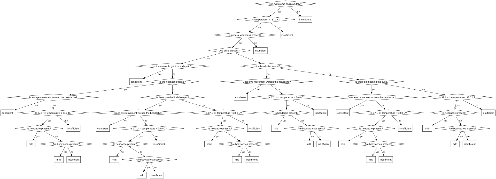
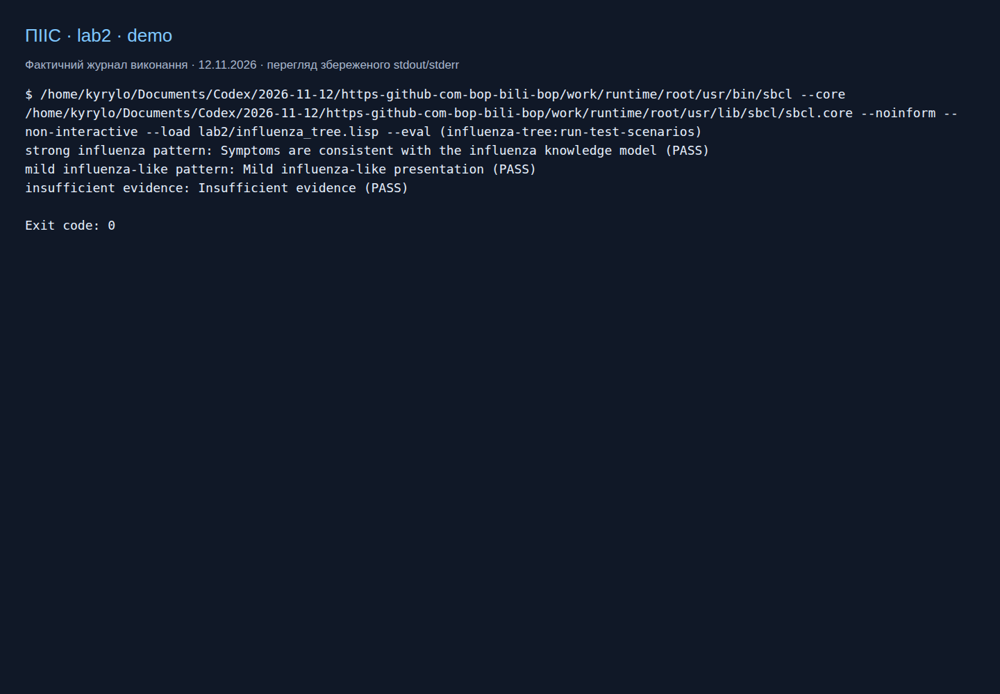
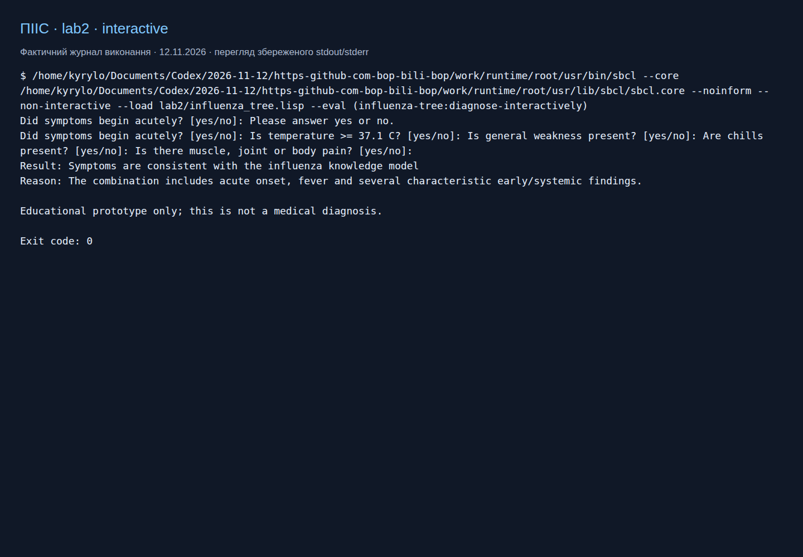

# Лабораторна робота №2 — Common Lisp

## Завдання та мета

Варіант 6. Побудувати двійкове дерево рішень для предметної області лабораторної №1 та реалізувати рекурсивний обхід на Lisp.

## Предметна область і прийнята модель

Варіант **6 «Грип»**, успадкований з початкової гілки репозиторію.
Опис варіанта: гострий початок, підвищення температури, озноб, головний біль
(лобовий або за очима, що посилюється при русі очей), загальна слабкість,
м'язовий/суглобовий біль і ломота. У PDF наведено також пітливість,
світлобоязнь, кон'юнктивіт, сльозотечу та тяжкі неврологічні прояви.

Для навчальної формалізації прийнято поріг підвищення температури 37.1 °C,
субфебрильний інтервал [37.1, 38.0), дуже високу температуру від 39.5 °C.
Ці числові пороги та наведені нижче комбінації — припущення реалізації,
а не дослівно задані діагностичні критерії PDF і не медичні рекомендації.

Позначення: A — гострий початок, F — температура ≥37.1, W — слабкість,
C — озноб, P — м'язовий/суглобовий біль або ломота,
L — лобовий біль або біль за очима, E — посилення при русі очей,
H — головний біль, B — ломота у тілі, S — субфебрильна температура.

1. Якщо **A ∧ F ∧ W ∧ ((C ∧ P) ∨ (L ∧ E))**, ознаки відповідають моделі грипу.
2. Інакше якщо **A ∧ S ∧ W ∧ (H ∨ B)**, легка грипоподібна картина.
3. Інакше даних для моделі недостатньо.

Перша умова має пріоритет над другою. Відсутній факт означає відсутність
підтвердження у цій навчальній моделі. Це не підтвердження відсутності симптому.
Для порівняння реалізацій використано повністю задані булеві набори ознак.

## Двійкове дерево

Кожен внутрішній вузол — структура `question` із текстом питання та двома
гілками, кожен листок — `conclusion`. Спільні суфікси в пам'яті повторно
використовуються; експортер розгортає їх у повне двійкове дерево, тому
графічна схема точно відповідає фактичному коду. Напрямки підписано yes/no.
Схема велика: відкрийте SVG окремо для збільшення.



[SVG](influenza_tree.svg) · [Graphviz DOT](influenza_tree.dot)

`traverse-tree` рекурсивно обирає одну з двох гілок. Постачальник відповідей —
функція: або консольне запитання, або пошук у списку асоціацій. У детермінованому
режимі пропущена відповідь або значення, відмінне від T/NIL, спричиняє помилку.
Інтерактивний режим повторює запит при неправильному вводі та обробляє EOF.

## Текст налагодженої програми

### `lab2/influenza_tree.lisp`

```lisp
;;;; Laboratory work 2, variant 6: "Influenza"
;;;; Educational decision tree only; it is not a medical diagnostic tool.

(defpackage :influenza-tree
  (:use :cl)
  (:export :*influenza-tree* :diagnose-interactively :diagnose-with-answers
           :run-test-scenarios))

(in-package :influenza-tree)

(defstruct question
  "A binary decision-tree node. YES-BRANCH and NO-BRANCH are nodes or leaves."
  id
  prompt
  yes-branch
  no-branch)

(defstruct conclusion
  "An educational conclusion stored in a leaf of the tree."
  id
  label
  explanation)

(defparameter *consistent*
  (make-conclusion
   :id :consistent
   :label "Symptoms are consistent with the influenza knowledge model"
   :explanation
   "The combination includes acute onset, fever and several characteristic early/systemic findings."))

(defparameter *mild*
  (make-conclusion
   :id :mild
   :label "Mild influenza-like presentation"
   :explanation
   "Acute onset, subfebrile temperature and weakness accompany headache or body aches."))

(defparameter *insufficient*
  (make-conclusion
   :id :insufficient
   :label "Insufficient evidence"
   :explanation
   "The supplied answers do not form one of the influenza patterns represented by this educational tree."))

;; Each internal node asks one Boolean question. Expand branches when drawing
;; so the report shows a tree even though identical suffixes share Lisp objects.
(defun decision (id prompt yes no)
  (make-question :id id :prompt prompt :yes-branch yes :no-branch no))

(defparameter *influenza-tree*
  (let* ((mild-tail
           (decision :subfebrile "Is 37.1 <= temperature < 38.0 C?"
             (decision :headache "Is headache present?" *mild*
               (decision :body-aches "Are body aches present?" *mild* *insufficient*))
             *insufficient*))
         (eye-movement
           (decision :eye-movement "Does eye movement worsen the headache?"
                     *consistent* mild-tail))
         (characteristic
           (decision :frontal-headache "Is the headache frontal?" eye-movement
             (decision :pain-behind-eyes "Is there pain behind the eyes?"
                       eye-movement mild-tail))))
    (decision :acute-onset "Did symptoms begin acutely?"
      (decision :elevated-temperature "Is temperature >= 37.1 C?"
        (decision :general-weakness "Is general weakness present?"
          (decision :chills "Are chills present?"
            (decision :aches "Is there muscle, joint or body pain?"
                      *consistent* characteristic)
            characteristic)
          *insufficient*)
        *insufficient*)
      *insufficient*)))

(defun ask-yes-no (prompt &optional (input *standard-input*)
                                    (output *standard-output*))
  "Ask PROMPT until the user enters yes/y or no/n, then return a Boolean."
  (loop
    (format output "~A [yes/no]: " prompt)
    (finish-output output)
    (let ((answer (read-line input nil nil)))
      (when (null answer)
        (error "End of input while waiting for a yes/no answer."))
      (cond ((member (string-downcase (string-trim '(#\Space #\Tab) answer))
                     '("yes" "y") :test #'string=)
             (return t))
            ((member (string-downcase (string-trim '(#\Space #\Tab) answer))
                     '("no" "n") :test #'string=)
             (return nil))
            (t (format output "Please answer yes or no.~%"))))))

(defun traverse-tree (node answer-provider)
  "Recursively traverse NODE, obtaining Booleans from ANSWER-PROVIDER."
  (etypecase node
    (conclusion node)
    (question
     (traverse-tree
      (if (funcall answer-provider node)
          (question-yes-branch node)
          (question-no-branch node))
      answer-provider))))

(defun print-conclusion (result &optional (stream *standard-output*))
  (format stream "~%Result: ~A~%Reason: ~A~%~%Educational prototype only; this is not a medical diagnosis.~%"
          (conclusion-label result)
          (conclusion-explanation result))
  result)

(defun diagnose-interactively ()
  "Traverse the influenza tree interactively and print its educational result."
  (print-conclusion
   (traverse-tree *influenza-tree*
                  (lambda (node) (ask-yes-no (question-prompt node))))))

(defun diagnose-with-answers (answers)
  "Deterministically traverse the tree using an alist of (:QUESTION-ID . BOOLEAN).

Only questions reached on the selected path need answers. A missing answer is
reported as an error, which makes scenarios reproducible and prevents an
unknown observation from being silently interpreted as NO."
  (traverse-tree
   *influenza-tree*
   (lambda (node)
     (let ((entry (assoc (question-id node) answers)))
       (unless entry
         (error "No deterministic answer supplied for ~S." (question-id node)))
       (unless (member (cdr entry) '(t nil))
         (error "Answer must be T or NIL for ~S." (question-id node)))
       (cdr entry)))))

(defparameter *test-scenarios*
  (list
   (list :name "strong influenza pattern"
         :answers '((:acute-onset . t) (:elevated-temperature . t)
                    (:general-weakness . t) (:chills . t) (:aches . t))
         :expected :consistent)
   (list :name "mild influenza-like pattern"
         :answers '((:acute-onset . t) (:elevated-temperature . t)
                    (:general-weakness . t) (:chills . nil)
                    (:frontal-headache . nil) (:pain-behind-eyes . nil)
                    (:subfebrile . t) (:headache . t))
         :expected :mild)
   (list :name "insufficient evidence"
         :answers '((:acute-onset . nil))
         :expected :insufficient)))

(defun run-test-scenarios (&optional (stream *standard-output*))
  "Run and assert the three deterministic demonstration scenarios."
  (dolist (scenario *test-scenarios* t)
    (let* ((result (diagnose-with-answers (getf scenario :answers)))
           (actual (conclusion-id result))
           (expected (getf scenario :expected)))
      (format stream "~A: ~A (~A)~%"
              (getf scenario :name) (conclusion-label result)
              (if (eql actual expected) "PASS" "FAIL"))
      (assert (eql actual expected) ()
              "Scenario ~A expected ~S but got ~S."
              (getf scenario :name) expected actual))))


(defun export-dot (&optional (path "lab2/influenza_tree.dot"))
  "Export the actual runtime tree; duplicate shared suffixes for a binary tree."
  (with-open-file (out path :direction :output :if-exists :supersede)
    (format out "digraph Influenza {~%node [fontname=Arial];~%")
    (let ((counter 0))
      (labels ((visit (node)
                 (let ((id (incf counter)))
                   (etypecase node
                     (conclusion
                      (format out "n~D [shape=box, label=~S];~%" id
                              (string-downcase (symbol-name (conclusion-id node)))))
                     (question
                      (format out "n~D [shape=diamond, label=~S];~%" id
                              (question-prompt node))
                      (dolist (branch (list (cons "yes" (question-yes-branch node))
                                           (cons "no" (question-no-branch node))))
                        (format out "n~D -> n~D [label=~S];~%"
                                id (visit (cdr branch)) (car branch)))))
                   id)))
        (visit *influenza-tree*)))
    (format out "}~%")))
```

## Результати фактичного запуску

Перевірено 12.11.2026. PNG нижче — скріншоти перегляду збережених журналів
stdout/stderr у браузері. Це не зображення інтерактивного термінала.
Початкові текстові журнали доступні поруч для перевірки.

### demo

[Повний журнал](results/demo.txt)



```text
$ /home/kyrylo/Documents/Codex/2026-11-12/https-github-com-bop-bili-bop/work/runtime/root/usr/bin/sbcl --core /home/kyrylo/Documents/Codex/2026-11-12/https-github-com-bop-bili-bop/work/runtime/root/usr/lib/sbcl/sbcl.core --noinform --non-interactive --load lab2/influenza_tree.lisp --eval (influenza-tree:run-test-scenarios)
strong influenza pattern: Symptoms are consistent with the influenza knowledge model (PASS)
mild influenza-like pattern: Mild influenza-like presentation (PASS)
insufficient evidence: Insufficient evidence (PASS)

Exit code: 0
```

### interactive

[Повний журнал](results/interactive.txt)



```text
$ /home/kyrylo/Documents/Codex/2026-11-12/https-github-com-bop-bili-bop/work/runtime/root/usr/bin/sbcl --core /home/kyrylo/Documents/Codex/2026-11-12/https-github-com-bop-bili-bop/work/runtime/root/usr/lib/sbcl/sbcl.core --noinform --non-interactive --load lab2/influenza_tree.lisp --eval (influenza-tree:diagnose-interactively)
Did symptoms begin acutely? [yes/no]: Please answer yes or no.
Did symptoms begin acutely? [yes/no]: Is temperature >= 37.1 C? [yes/no]: Is general weakness present? [yes/no]: Are chills present? [yes/no]: Is there muscle, joint or body pain? [yes/no]: 
Result: Symptoms are consistent with the influenza knowledge model
Reason: The combination includes acute onset, fever and several characteristic early/systemic findings.

Educational prototype only; this is not a medical diagnosis.

Exit code: 0
```

## Висновок

Використано `defstruct`, `defparameter`, `defun`, `let*`, `if`, `loop`,
`cond`, `etypecase`, `funcall`, `lambda`, `assoc`, `member`, `read-line`,
`format`, `dolist`, `assert`, `labels`, `with-open-file` та рекурсію.
Три контрольні сценарії та інтерактивний запуск пройшли успішно.
Узгодженість усіх 6144 комбінацій з Prolog і CLIPS перевіряється
спільним скриптом `scripts/check_models.py`.
