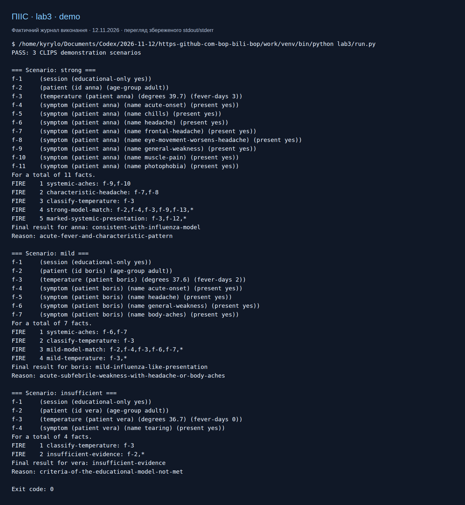
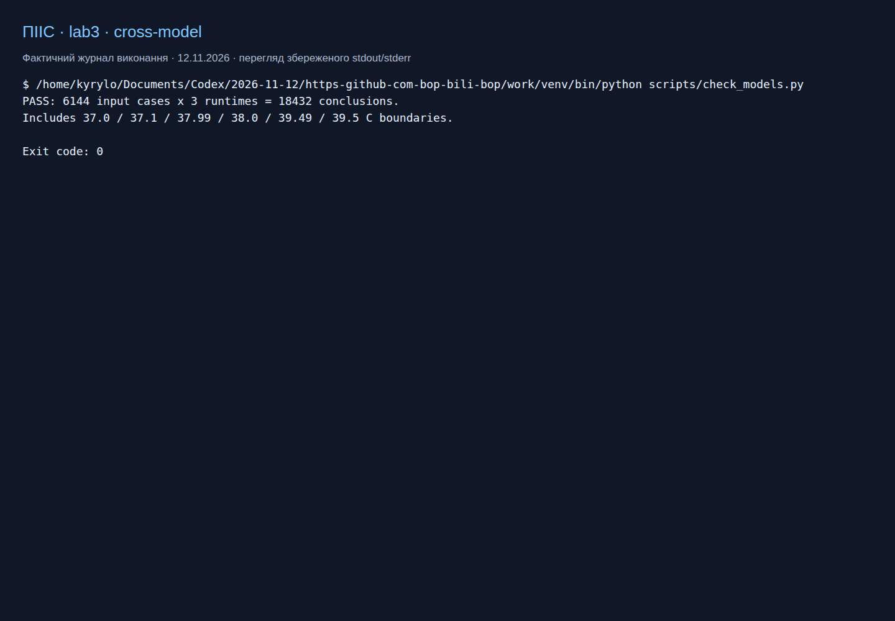

# Лабораторна робота №3 — CLIPS

## Завдання та мета

Варіант 6. Описати поле знань, факти та правила, ієрархію понять і реалізувати експертний прототип із прямим виведенням.

## Предметна область і прийнята модель

Варіант **6 «Грип»**, успадкований з початкової гілки репозиторію.
Опис варіанта: гострий початок, підвищення температури, озноб, головний біль
(лобовий або за очима, що посилюється при русі очей), загальна слабкість,
м'язовий/суглобовий біль і ломота. У PDF наведено також пітливість,
світлобоязнь, кон'юнктивіт, сльозотечу та тяжкі неврологічні прояви.

Для навчальної формалізації прийнято поріг підвищення температури 37.1 °C,
субфебрильний інтервал [37.1, 38.0), дуже високу температуру від 39.5 °C.
Ці числові пороги та наведені нижче комбінації — припущення реалізації,
а не дослівно задані діагностичні критерії PDF і не медичні рекомендації.

Позначення: A — гострий початок, F — температура ≥37.1, W — слабкість,
C — озноб, P — м'язовий/суглобовий біль або ломота,
L — лобовий біль або біль за очима, E — посилення при русі очей,
H — головний біль, B — ломота у тілі, S — субфебрильна температура.

1. Якщо **A ∧ F ∧ W ∧ ((C ∧ P) ∨ (L ∧ E))**, ознаки відповідають моделі грипу.
2. Інакше якщо **A ∧ S ∧ W ∧ (H ∨ B)**, легка грипоподібна картина.
3. Інакше даних для моделі недостатньо.

Перша умова має пріоритет над другою. Відсутній факт означає відсутність
підтвердження у цій навчальній моделі. Це не підтвердження відсутності симптому.
Для порівняння реалізацій використано повністю задані булеві набори ознак.

## Поле знань та ієрархія понять

```text
Навчальна сесія
└── Пацієнт (ідентифікатор, вікова група)
    ├── Спостереження
    │   ├── Температура (градуси, дні лихоманки)
    │   └── Симптом (назва, наявність yes/no)
    ├── Свідчення
    │   ├── Температурна категорія і типовий період 2–6 днів
    │   ├── Слабкість та ломота
    │   └── Характерний локалізований головний біль
    ├── Вираженість (mild / marked / severe)
    └── Висновок (відповідність моделі / легка картина / недостатньо даних)
```

Факти `patient`, `symptom`, `temperature` задають спостереження.
Якщо є слабкість і будь-який вид ломоти, виводиться `systemic-aches`.
Якщо локалізований головний біль посилюється при русі очей, виводиться
`characteristic-headache`. Числова температура класифікується функцією
`temperature-band`. Далі застосовуються три правила висновку з попереднього
розділу. Дуже висока температура та блювання/галюцинації/неврологічний симптом/
судоми утворюють навчальну категорію `severe`, інакше висока температура зі
слабкістю та ломотою — `marked`; субфебрильна — `mild`.

## Послідовність активації

CLIPS використовує пряме виведення. Спочатку правила свідчень (salience 50),
потім сильний висновок (30), легкий (20), тяжкість (10, 5, 0), резервний
висновок (-100). Таким чином легкий або резервний висновок не випереджає
побудову потрібних свідчень. Умова `not` запобігає дублюванню висновків і
конфліктним рівням тяжкості. Перед кожним прикладом виконується `reset`.
Журнал `watch rules` містить фактичні активації `FIRE`, вихідні факти та висновки.

## Текст налагодженої програми

### `lab3/influenza.clp`

```clips
; Лабораторна робота №3, варіант 6: «Грип».
; Навчальна модель і демонстрація логічного виведення; не є медичним діагнозом.

(defglobal
  ?*high-temperature* = 39.5
  ?*subfebrile-min* = 37.1
  ?*subfebrile-max* = 38.0)

(deftemplate session
  (slot educational-only (allowed-symbols yes no) (default yes)))

(deftemplate patient
  (slot id)
  (slot age-group (allowed-symbols child adult) (default adult)))

(deftemplate symptom
  (slot patient)
  (slot name)
  (slot present (allowed-symbols yes no) (default yes)))

(deftemplate temperature
  (slot patient)
  (slot degrees (type NUMBER))
  (slot fever-days (type INTEGER) (default 0)))

(deftemplate evidence
  (slot patient)
  (slot kind)
  (slot explanation))

(deftemplate severity
  (slot patient)
  (slot level (allowed-symbols mild marked severe)))

(deftemplate diagnostic-result
  (slot patient)
  (slot conclusion
    (allowed-symbols consistent-with-influenza-model
                     mild-influenza-like-presentation
                     insufficient-evidence))
  (slot explanation))

; deffacts creates only permanent model metadata. Scenario facts are selected
; independently by load-scenario, so demonstrations cannot contaminate each other.
(deffacts initial-model-state
  (session (educational-only yes)))

(deffunction temperature-band (?degrees)
  (if (>= ?degrees ?*high-temperature*) then
    (return very-high))
  (if (and (>= ?degrees ?*subfebrile-min*)
           (< ?degrees ?*subfebrile-max*)) then
    (return subfebrile))
  (if (>= ?degrees ?*subfebrile-max*) then
    (return elevated))
  (return normal))

(deffunction clear-case ()
  (do-for-all-facts ((?f patient)) TRUE (retract ?f))
  (do-for-all-facts ((?f symptom)) TRUE (retract ?f))
  (do-for-all-facts ((?f temperature)) TRUE (retract ?f))
  (do-for-all-facts ((?f evidence)) TRUE (retract ?f))
  (do-for-all-facts ((?f severity)) TRUE (retract ?f))
  (do-for-all-facts ((?f diagnostic-result)) TRUE (retract ?f)))

(deffunction load-scenario (?scenario)
  (clear-case)
  (if (eq ?scenario strong) then
    (assert (patient (id anna) (age-group adult)))
    (assert (temperature (patient anna) (degrees 39.7) (fever-days 3)))
    (assert (symptom (patient anna) (name acute-onset)))
    (assert (symptom (patient anna) (name chills)))
    (assert (symptom (patient anna) (name headache)))
    (assert (symptom (patient anna) (name frontal-headache)))
    (assert (symptom (patient anna) (name eye-movement-worsens-headache)))
    (assert (symptom (patient anna) (name general-weakness)))
    (assert (symptom (patient anna) (name muscle-pain)))
    (assert (symptom (patient anna) (name photophobia))))
  (if (eq ?scenario mild) then
    (assert (patient (id boris) (age-group adult)))
    (assert (temperature (patient boris) (degrees 37.6) (fever-days 2)))
    (assert (symptom (patient boris) (name acute-onset)))
    (assert (symptom (patient boris) (name headache)))
    (assert (symptom (patient boris) (name general-weakness)))
    (assert (symptom (patient boris) (name body-aches))))
  (if (eq ?scenario insufficient) then
    (assert (patient (id vera) (age-group adult)))
    (assert (temperature (patient vera) (degrees 36.7) (fever-days 0)))
    (assert (symptom (patient vera) (name tearing)))))

(deffunction show-result ()
  (do-for-all-facts ((?r diagnostic-result)) TRUE
    (printout t "Final result for " ?r:patient ": " ?r:conclusion crlf
                "Reason: " ?r:explanation crlf)))

(deffunction run-scenario (?scenario)
  (reset)
  (load-scenario ?scenario)
  (printout t crlf "=== Scenario: " ?scenario " ===" crlf)
  (facts)
  (run)
  (show-result))

; Intermediate evidence is completed before choosing a conclusion.
(defrule classify-temperature
  (declare (salience 50))
  (temperature (patient ?p) (degrees ?degrees) (fever-days ?days))
  =>
  (assert (evidence (patient ?p) (kind temperature-classified)
                    (explanation (temperature-band ?degrees))))
  (if (and (>= ?days 2) (<= ?days 6)) then
    (assert (evidence (patient ?p) (kind typical-fever-duration)
                      (explanation two-to-six-days)))))

(defrule systemic-aches
  (declare (salience 50))
  (symptom (patient ?p) (name general-weakness) (present yes))
  (or (symptom (patient ?p) (name muscle-pain) (present yes))
      (symptom (patient ?p) (name joint-pain) (present yes))
      (symptom (patient ?p) (name body-aches) (present yes)))
  =>
  (assert (evidence (patient ?p) (kind systemic-aches)
                    (explanation weakness-and-aches))))

(defrule characteristic-headache
  (declare (salience 50))
  (or (symptom (patient ?p) (name frontal-headache) (present yes))
      (symptom (patient ?p) (name pain-behind-eyes) (present yes)))
  (symptom (patient ?p) (name eye-movement-worsens-headache) (present yes))
  =>
  (assert (evidence (patient ?p) (kind characteristic-headache)
                    (explanation eye-movement-worsens-localized-headache))))

(defrule strong-model-match
  (declare (salience 30))
  (patient (id ?p))
  (symptom (patient ?p) (name acute-onset) (present yes))
  (temperature (patient ?p) (degrees ?t&:(>= ?t ?*subfebrile-min*)))
  (symptom (patient ?p) (name general-weakness) (present yes))
  (or (and (symptom (patient ?p) (name chills) (present yes))
           (evidence (patient ?p) (kind systemic-aches)))
      (evidence (patient ?p) (kind characteristic-headache)))
  (not (diagnostic-result (patient ?p)))
  =>
  (assert (diagnostic-result (patient ?p)
            (conclusion consistent-with-influenza-model)
            (explanation acute-fever-and-characteristic-pattern))))

(defrule mild-model-match
  (declare (salience 20))
  (patient (id ?p))
  (symptom (patient ?p) (name acute-onset) (present yes))
  (temperature (patient ?p) (degrees ?t&:(and (>= ?t ?*subfebrile-min*)
                                              (< ?t ?*subfebrile-max*))))
  (symptom (patient ?p) (name general-weakness) (present yes))
  (or (symptom (patient ?p) (name headache) (present yes))
      (symptom (patient ?p) (name body-aches) (present yes)))
  (not (diagnostic-result (patient ?p)))
  =>
  (assert (diagnostic-result (patient ?p)
            (conclusion mild-influenza-like-presentation)
            (explanation acute-subfebrile-weakness-with-headache-or-body-aches))))

(defrule severe-neurological-signs
  (declare (salience 10))
  (temperature (patient ?p) (degrees ?t&:(>= ?t ?*high-temperature*)))
  (or (symptom (patient ?p) (name vomiting) (present yes))
      (symptom (patient ?p) (name hallucinations) (present yes))
      (symptom (patient ?p) (name nervous-system-symptom) (present yes))
      (symptom (patient ?p) (name seizures) (present yes)))
  (not (severity (patient ?p)))
  =>
  (assert (severity (patient ?p) (level severe))))

(defrule marked-systemic-presentation
  (declare (salience 5))
  (temperature (patient ?p) (degrees ?t&:(>= ?t ?*high-temperature*)))
  (evidence (patient ?p) (kind systemic-aches))
  (not (severity (patient ?p)))
  =>
  (assert (severity (patient ?p) (level marked))))

(defrule mild-temperature
  (temperature (patient ?p) (degrees ?t&:(and (>= ?t ?*subfebrile-min*)
                                              (< ?t ?*subfebrile-max*))))
  (not (severity (patient ?p)))
  =>
  (assert (severity (patient ?p) (level mild))))

(defrule insufficient-evidence
  (declare (salience -100))
  (patient (id ?p))
  (not (diagnostic-result (patient ?p)))
  =>
  (assert (diagnostic-result (patient ?p)
            (conclusion insufficient-evidence)
            (explanation criteria-of-the-educational-model-not-met))))
```

### `lab3/run.py`

```python
"""Run actual CLIPS rules through clipspy (the CLIPS C engine)."""
from pathlib import Path
import clips


def main():
    env = clips.Environment()
    env.load(str(Path(__file__).with_name('influenza.clp')))
    env.eval('(watch rules)')
    for name in ('strong', 'mild', 'insufficient'):
        env.eval(f'(run-scenario {name})')
        results = [f for f in env.facts() if f.template.name == 'diagnostic-result']
        assert len(results) == 1
        expected = {'strong': 'consistent-with-influenza-model',
                    'mild': 'mild-influenza-like-presentation',
                    'insufficient': 'insufficient-evidence'}[name]
        assert str(results[0]['conclusion']) == expected
    print('PASS: 3 CLIPS demonstration scenarios', flush=True)


if __name__ == '__main__':
    main()
```

## Результати фактичного запуску

Перевірено 12.11.2026. PNG нижче — скріншоти перегляду збережених журналів
stdout/stderr у браузері. Це не зображення інтерактивного термінала.
Початкові текстові журнали доступні поруч для перевірки.

### demo

[Повний журнал](results/demo.txt)



```text
$ /home/kyrylo/Documents/Codex/2026-11-12/https-github-com-bop-bili-bop/work/venv/bin/python lab3/run.py
PASS: 3 CLIPS demonstration scenarios

=== Scenario: strong ===
f-1     (session (educational-only yes))
f-2     (patient (id anna) (age-group adult))
f-3     (temperature (patient anna) (degrees 39.7) (fever-days 3))
f-4     (symptom (patient anna) (name acute-onset) (present yes))
f-5     (symptom (patient anna) (name chills) (present yes))
f-6     (symptom (patient anna) (name headache) (present yes))
f-7     (symptom (patient anna) (name frontal-headache) (present yes))
f-8     (symptom (patient anna) (name eye-movement-worsens-headache) (present yes))
f-9     (symptom (patient anna) (name general-weakness) (present yes))
f-10    (symptom (patient anna) (name muscle-pain) (present yes))
f-11    (symptom (patient anna) (name photophobia) (present yes))
For a total of 11 facts.
FIRE    1 systemic-aches: f-9,f-10
FIRE    2 characteristic-headache: f-7,f-8
FIRE    3 classify-temperature: f-3
FIRE    4 strong-model-match: f-2,f-4,f-3,f-9,f-13,*
FIRE    5 marked-systemic-presentation: f-3,f-12,*
Final result for anna: consistent-with-influenza-model
Reason: acute-fever-and-characteristic-pattern

=== Scenario: mild ===
f-1     (session (educational-only yes))
f-2     (patient (id boris) (age-group adult))
f-3     (temperature (patient boris) (degrees 37.6) (fever-days 2))
f-4     (symptom (patient boris) (name acute-onset) (present yes))
f-5     (symptom (patient boris) (name headache) (present yes))
f-6     (symptom (patient boris) (name general-weakness) (present yes))
f-7     (symptom (patient boris) (name body-aches) (present yes))
For a total of 7 facts.
FIRE    1 systemic-aches: f-6,f-7
FIRE    2 classify-temperature: f-3
FIRE    3 mild-model-match: f-2,f-4,f-3,f-6,f-7,*
FIRE    4 mild-temperature: f-3,*
Final result for boris: mild-influenza-like-presentation
Reason: acute-subfebrile-weakness-with-headache-or-body-aches

=== Scenario: insufficient ===
f-1     (session (educational-only yes))
f-2     (patient (id vera) (age-group adult))
f-3     (temperature (patient vera) (degrees 36.7) (fever-days 0))
f-4     (symptom (patient vera) (name tearing) (present yes))
For a total of 4 facts.
FIRE    1 classify-temperature: f-3
FIRE    2 insufficient-evidence: f-2,*
Final result for vera: insufficient-evidence
Reason: criteria-of-the-educational-model-not-met

Exit code: 0
```

### cross-model

[Повний журнал](results/cross-model.txt)



```text
$ /home/kyrylo/Documents/Codex/2026-11-12/https-github-com-bop-bili-bop/work/venv/bin/python scripts/check_models.py
PASS: 6144 input cases x 3 runtimes = 18432 conclusions.
Includes 37.0 / 37.1 / 37.99 / 38.0 / 39.49 / 39.5 C boundaries.

Exit code: 0
```

## Висновок

Використано `deftemplate`, `deffacts`, `defrule`, `deffunction`, `defglobal`,
`assert`, `retract`, `reset`, `run`, `test`, `or`, `and`, `not` та `salience`.
Реальний CLIPS C engine запущено через clipspy. Перевірено три сценарії,
порядок активації та узгодженість 6144 наборів з двома іншими реалізаціями.
